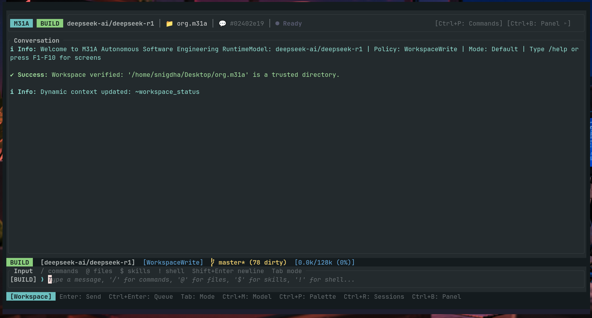
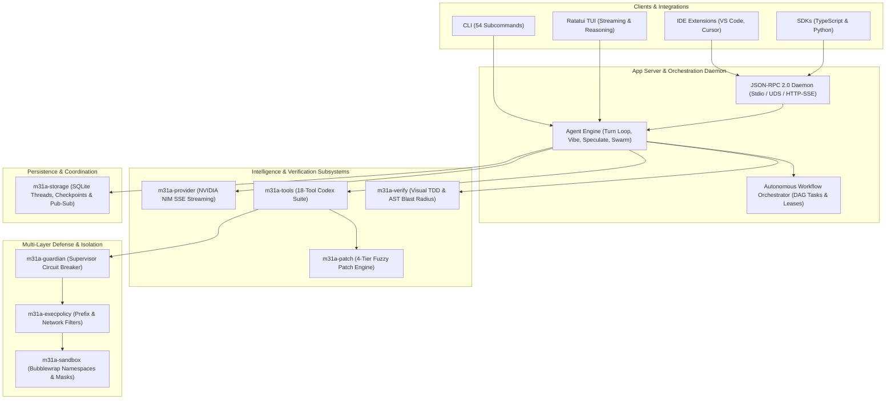
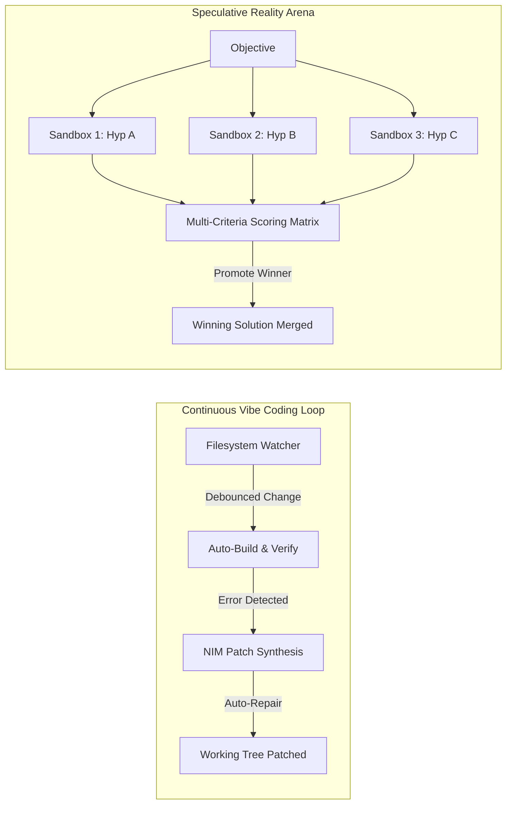

<div align="center">
  
  <h1>M31A</h1>
  <p><strong>Next-Generation Autonomous Agentic Coding Assistant</strong></p>
  <p><em>Codex-grade multi-file patch synthesis, continuous vibe coding auto-healing, and speculative parallel execution — powered by NVIDIA NIM frontier intelligence.</em></p>

  <p align="center">
    <a href="https://github.com/eshanized/M31A/releases/latest"></a>
    <a href="https://www.rust-lang.org/"></a>
    <a href="https://build.nvidia.com/"></a>
    <a href="https://github.com/bubblewrap/bubblewrap"></a>
    <a href="https://opensource.org/licenses/MIT"></a>
  </p>

  <p align="center">
    <a href="https://github.com/eshanized/M31A/actions/workflows/ci.yml"></a>
    <a href="https://m31a.tonmoyinfrastructure.org/"></a>
    <a href="https://npmjs.com/package/@m31a/sdk"></a>
    <a href="https://pypi.org/project/m31a/"></a>
    
    
  </p>
</div>

```
                 __  __ _____  _    _        
                |  \/  |___ / / |  / \       
                | |\/| | |_ \ | | / _ \      
                | |  | |___) || |/ ___ \     
                |_|  |_|____/ |_/_/   \_\    
```

<p align="center">
  <a href="#what-is-m31a">About</a> •
  <a href="#key-capabilities--breakthrough-innovations">Key Capabilities</a> •
  <a href="#quickstart-guide">Quickstart</a> •
  <a href="#interactive-terminal-ui-tui">Terminal UI</a> •
  <a href="#system-architecture">Architecture</a> •
  <a href="#18-tool-orchestration-suite">18-Tool Suite</a> •
  <a href="#cli-command-reference">CLI Reference</a> •
  <a href="#configuration-reference">Configuration</a> •
  <a href="#sdk-ecosystem-typescript--python">SDKs</a> •
  <a href="#performance--benchmark-metrics">Benchmarks</a> •
  <a href="#workspace-monorepo-layout-39-crates">39 Crates</a> •
  <a href="#documentation-index">Documentation</a>
</p>

---

## 📸 Interactive Terminal Interface

<p align="center">
  
</p>
<p align="center"><em>M31A full-screen interactive Terminal User Interface (Ratatui/Crossterm) with streaming reasoning traces, AST syntax highlighting, and live tool card outputs.</em></p>

---

## 🌟 What is M31A?

**M31A** is a high-performance, sovereign, autonomous agentic coding assistant designed from first principles as an open-source alternative to proprietary AI engineering tools (such as OpenAI Codex CLI, Cursor, and Claude Code).

Engineered in modern **Rust 2024 edition (1.85+)** across a **39-crate modular monorepo**, M31A couples low-latency **NVIDIA NIM** frontier models (Nemotron 3.5, DeepSeek R1 / v4.1 Flash, Codestral, and Llama 3.1) with kernel-level **Linux Bubblewrap (`bwrap`) sandboxing**, **AST semantic blast-radius gating**, **automated visual TDD via headless Chromium**, and a **4-tier fuzzy multi-file patch engine**.

Whether running as an interactive full-screen **Ratatui Terminal UI**, executing in **continuous vibe coding auto-healing loops**, evaluating competing architectural designs in a **speculative parallel reality arena**, or serving IDE extensions over **JSON-RPC 2.0 (stdio, UDS, HTTP/SSE)**, M31A delivers zero-babysitter autonomy without compromising security.

- **Author**: [Eshan Roy](https://github.com/eshanized)
- **License**: [MIT](LICENSE)
- **Documentation**: [https://m31a.tonmoyinfrastructure.org/](https://m31a.tonmoyinfrastructure.org/)
- **Repository**: [https://github.com/eshanized/M31A](https://github.com/eshanized/M31A)

---

## ⚡ Key Capabilities & Breakthrough Innovations

### 1. 🔄 Continuous Flow-State & Vibe Coding Engine (`m31a vibe`)
Work in uninterrupted flow while M31A watches your workspace:
- **Debounced Filesystem Watcher (`m31a-watcher`)**: Watches your codebase non-intrusively with configurable debounce windows.
- **Zero-Babysitter Auto-Healing Loop (`m31a-agent-engine::vibe_loop`)**: Background verification catches compiler, linter, and type errors instantly, synthesizes targeted multi-file Codex patches via low-latency NVIDIA NIM models, and repairs the working tree automatically.
- **Continuous Visual Verification**: Optionally pair with `--visual-url http://localhost:3000` to automatically verify web frontends on every file save.

### 2. 🌌 Speculative Parallel Reality Arena (`m31a speculate`)
Eliminate guesswork by testing competing implementations simultaneously:
- **Concurrent Hypothesis Sandboxes (`m31a-agent-engine::speculative`)**: Spins up isolated temporary sandbox workspaces to execute rival implementation strategies in parallel.
- **Composite Scoring Matrix**: Evaluates candidates across compiler diagnostics, unit/integration test suites, execution speed, and blast-radius safety.
- **Automated Winner Promotion**: The highest-scoring candidate branch is automatically merged directly into your active working tree (`--promote`).

### 3. 🧪 Autonomous Visual TDD Engine (`m31a-verify` & `m31a-browser`)
Test web applications visually before committing:
- **Headless Chromium CDP Controller**: Validates live DOM element presence, visibility, exact text match, computed CSS styles, and attribute states.
- **Invariant Enforcement**: Asserts zero unhandled browser console errors, zero HTTP 4xx/5xx network failures, and captures high-resolution screenshot artifacts.
- **Self-Healing Guidance**: Generates actionable visual regression feedback directly for the agent patch loop.

### 4. 🔀 Autonomous Workflow Orchestrator (`m31a workflow`)
Enterprise-grade orchestration for complex multi-phase software objectives:
- **Directed Acyclic Graph (DAG) Execution**: Typed tasks (`TaskKind::Plan`, `TaskKind::Execute`, `TaskKind::Verify`, `TaskKind::Review`) with deterministic dependency fencing.
- **Worker Leases & Checkpoints**: Transactional worker leasing, append-only event logging, content-addressed artifact tracking, and instant rollback.
- **Full CLI Suite**: `m31a workflow run`, `status`, `inspect`, `resume`, `cancel`, `events`, and `artifacts`.

### 5. 🩹 OpenAI Codex-Grade 4-Tier Fuzzy Patch Engine (`m31a-patch`)
Flawlessly applies AI-generated code modifications without offset corruption:
- **Codex Patch Specification Support**: `*** Begin Patch`, `*** Add File:`, `*** Delete File:`, `*** Update File:`, `*** Move to:`, `@@ context`, `*** End Patch`.
- **4-Tier Fuzzy Seek Engine (`seek_sequence`)**:
  1. *Exact match*: Direct byte-for-byte slice matching.
  2. *Right-strip whitespace*: Ignores trailing carriage returns and spaces.
  3. *Full trim*: Matches line content regardless of leading/trailing indentation shifts.
  4. *Unicode Typographic Normalization*: Tolerates smart quotes, typographic hyphens/dashes, and non-breaking spaces.

### 6. 🛡️ Multi-Layer Defense-in-Depth Security Architecture
Execute untrusted AI code safely without risking host contamination:
- **Linux Bubblewrap Namespaces (`m31a-sandbox`)**: Unshares PID, IPC, UTS, and Mount namespaces. Mounts root filesystem strictly read-only (`ro-bind`).
- **Path Protection Masks**: Sensitive files (`.git`, `.m31a`, `.codex`, `.ssh`, `.env`, `*.pem`, `*.key`) are masked with read-only protections.
- **AST & Prefix ExecPolicy (`m31a-execpolicy`)**: Evaluates command tokens against pattern rules with alternative tokens (`PatternToken::Alts`) and network destination filters (`allow`, `prompt`, `deny`).
- **Guardian Reviewer (`m31a-guardian`)**: Out-of-band supervisor with a sliding-window circuit breaker (`AUTO_REVIEW_DENIAL_WINDOW_SIZE = 5`, `MAX_DENIALS_BEFORE_TRIP = 3`).
- **Trust Boundary & Git Hook Armor (`m31a-trust`)**: Defends against malicious repository configuration and unapproved hooks.

### 7. 🧠 Universal NVIDIA NIM Frontier Intelligence (`m31a-provider`)
Dynamic model discovery and streaming reasoning integration with [build.nvidia.com](https://build.nvidia.com/):
- `nvidia/nemotron-3.5-lightning-30b-a3b`: Default frontier workhorse with reasoning support.
- `nvidia/nemotron-3.5-bolt-e4b`: Ultra-low latency, high-efficiency instruction following.
- `deepseek-ai/deepseek-v4.1-flash`: Frontier reasoning model with thinking stream introspection.
- `mistralai/codestral-22b-instruct-v0.1`: Specialized for code synthesis and architectural refactoring.
- `nvidia/llama-3.1-nemotron-70b-instruct`: Benchmark-leading precision for structured tool calling.
- *Support for any hosted or custom remote NIM model slug without restriction.*

### 8. 🔌 JSON-RPC 2.0 App Server Daemon (`m31a-app-server`)
Integrate M31A into IDEs (VS Code, Cursor) and automation pipelines:
- **Transports**: Standard I/O (`stdio`), hardened Unix Domain Sockets (`.sock`), and HTTP/SSE.
- **40+ Standardized Protocol Methods**: Complete control over threads, turns, checkpoints, locks, multi-agent pub-sub board, goals, and external MCP servers.

---

## 🧰 18-Tool Orchestration Suite

M31A equips agents with a hardened suite of 18 built-in tools governed by sandbox execution policies:

| Category | Tool | Description |
| :--- | :--- | :--- |
| **Execution** | `exec_command` | Execute shell commands inside the Bubblewrap sandbox with timeout and output capture. |
| | `write_stdin` | Stream input to interactive background processes and child pipes. |
| **Filesystem** | `read_file` | Read file contents with optional line offset, byte range, and size bounds. |
| | `write_file` | Atomically create or overwrite workspace files. |
| | `apply_patch` | Apply OpenAI Codex multi-file patches with 4-tier fuzzy matching. |
| | `list_dir` | Explore directory structures with depth constraints and gitignore respect. |
| | `file_search` | High-speed regex and glob pattern search across codebase filenames. |
| | `view_image` | Inspect local images (PNG, JPEG, SVG) for multimodal reasoning. |
| **Interactive & Discovery** | `request_user_input` | Prompt the user for clarifications, choices, or interactive guidance. |
| | `tool_search` | Dynamically discover available registered tools and MCP extensions. |
| **Multi-Agent Swarm** | `spawn_agent` | Launch an autonomous sub-agent with a dedicated role and isolated context. |
| | `send_input` | Dispatch instructions and messages to an active sub-agent. |
| | `wait_agent` | Await completion of a child agent and capture structured return artifacts. |
| | `close_agent` | Terminate and clean up an active sub-agent session. |
| | `list_agents` | Inspect all running agents, roles, and resource utilization. |
| **Goal Tracking** | `create_goal` | Initialize high-level mission goals with structured success criteria. |
| | `update_goal` | Track milestone progress, state transitions, and step outcomes. |
| | `get_goal` | Retrieve active mission objectives and hierarchical goal status. |

---

## 🏗️ System Architecture



### Speculative Arena & Vibe Coding Workflow



---

## ⚡ Quickstart Guide

### 1. Prerequisites

- **Rust**: Version 1.85+ (Rust 2024 edition).
- **Bubblewrap** (Linux sandbox isolation):
  ```bash
  # Debian / Ubuntu
  sudo apt install -y bubblewrap

  # Fedora / RHEL
  sudo dnf install -y bubblewrap

  # Arch Linux
  sudo pacman -S bubblewrap
  ```
- **NVIDIA NIM API Key**: Free API key from [build.nvidia.com](https://build.nvidia.com/).

### 2. Build & Install

#### Option A: One-Liner Quick Install (Linux)

Install M31A automatically with architecture detection, dependency verification, and PATH setup:

```bash
curl -fsSL https://raw.githubusercontent.com/eshanized/M31A/master/install.sh | bash
```

To install a specific version or from a local binary:
```bash
./install.sh --version 0.1.14
./install.sh --binary ./target/release/m31a
```

#### Option B: Build from Source via Cargo

```bash
# Clone the repository
git clone https://github.com/eshanized/M31A.git
cd M31A

# Build and install the m31a binary
cargo install --path crates/m31a-cli

# Or build the release binary directly
cargo build --release -p m31a-cli
cp target/release/m31a ~/.local/bin/
```

#### Option C: Build and Test using Just

```bash
just release
just test-fast
```

#### Uninstallation & Clean Purge

To completely remove M31A and purge all configuration, SQLite databases, session checkpoints, and PATH entries:

```bash
# Using the installed uninstaller command
m31a-uninstall

# Or using the uninstallation script directly
curl -fsSL https://raw.githubusercontent.com/eshanized/M31A/master/uninstall.sh | bash
# Or: ./uninstall.sh --force
```

### 3. Configure Credentials

Export your key in your shell:
```bash
export NVIDIA_API_KEY="nvapi-..."
```

Or run the interactive onboarding setup wizard:
```bash
m31a setup
```

### 4. Verify System Health

Run the diagnostic healthcheck to inspect your environment, API credentials, Bubblewrap sandbox, and database integrity:
```bash
m31a doctor
```

### 5. Launch Interactive TUI

```bash
# Launch interactive TUI in active workspace
m31a

# Launch TUI pre-populated with an instruction prompt
m31a "Inspect the codebase, run tests, and fix any failed assertions"
```

---

## 🖥️ Interactive Terminal UI (TUI)

The M31A terminal user interface is powered by [Ratatui](https://ratatui.rs) and [Crossterm](https://github.com/crossterm-rs/crossterm).

### Keyboard Shortcuts

| Shortcut | Action | Description |
| :--- | :--- | :--- |
| `Ctrl + P` | **Fuzzy Command Palette** | Quick tool, slash command, and file launcher. |
| `Tab` / `Shift+Tab` | **Cycle Agent Mode** | Toggle between `[⚡ BUILD]` (autonomous) and `[📋 PLAN]` (advisory). |
| `!` *(prefix)* | **Instant Local Shell** | Execute shell commands immediately (e.g., `!cargo check`) and inject output. |
| `Enter` | **Submit Prompt** | Dispatch composer text to the active agent turn. |
| `Shift + Enter` | **Newline in Composer** | Insert newline without submitting. |
| `Ctrl + M` | **Model Selector Modal** | Switch NVIDIA NIM model on the fly. |
| `Ctrl + D` | **Git Diff Viewer** | View colorized uncommitted working tree diffs. |
| `Ctrl + R` | **Session Picker** | Browse and resume past SQLite conversation sessions. |
| `Ctrl + Y` | **Yank Code Block** | Extract and copy the latest assistant code snippet to system clipboard. |
| `Ctrl + T` | **Toggle Tool Folds** | Fold/unfold tool call cards and DeepSeek R1 reasoning traces. |
| `Ctrl + A` | **Token Analytics** | Inspect session token counts, turn latency, and pricing metrics. |
| `Ctrl + L` | **Clear Transcript** | Clear the visible viewport history. |
| `Ctrl + C` | **Interrupt / Cancel** | Cancel active generation; double-press to exit. |
| `Ctrl + Q` / `Esc` | **Close Dialog / Exit** | Dismiss active modal popup or exit application. |
| `?` *(empty prompt)* | **Help Overlay** | Display keyboard shortcuts and quick guidance. |
| `PgUp` / `PgDown` | **Scroll Transcript** | Scroll conversation history viewport. |

### Slash Commands

| Command | Action | Description |
| :--- | :--- | :--- |
| `/help` | **Help Center** | View comprehensive help card with all keybindings and commands. |
| `/settings` | **Settings Manager** | Open interactive settings modal (General, Security, TUI, Features). |
| `/palette` | **Command Palette** | Open the universal fuzzy action launcher. |
| `/build` | **Build Mode** | Switch to autonomous execution mode (mutations & tool execution enabled). |
| `/plan` | **Plan Mode** | Switch to advisory architecture mode (read-only exploration). |
| `/vibe` | **Vibe Coding** | Engage background auto-healing compiler loop. |
| `/visual [url]` | **Visual TDD** | Run autonomous headless Chromium visual verification on web frontend. |
| `/safety` | **Blast Radius Audit** | Audit codebase call-graph and data-flow taint invariants. |
| `/model [slug]` | **Model Switcher** | Open model modal or switch directly to a specified model slug. |
| `/diff` | **Git Diff** | Render colorized syntactic diff for uncommitted workspace changes. |
| `/undo` | **Undo Checkpoint** | Revert workspace and session to the previous checkpoint. |
| `/verify` | **Run Verification** | Execute autonomous compiler and linter checks on workspace. |
| `/test` | **Run Test Suite** | Execute workspace test suites with structured failure reporting. |
| `/review` | **Automated Review** | Conduct automated AI code review on current git changes. |
| `/analytics` | **Session Analytics** | Display token consumption, cost metrics, and execution latency. |
| `/apply` | **Apply Diff** | Inspect and verify working tree patch modifications. |
| `/fork` | **Fork Session** | Fork the active session thread into an independent branch. |
| `/clear` | **Clear Screen** | Clear the transcript viewport. |
| `/compact` | **Compact History** | Prune conversation turns to reduce token window context. |
| `/resume` | **Session Picker** | Browse and resume previous SQLite sessions. |
| `/checkpoints` | **Checkpoints DAG** | Browse snapshot checkpoints and revert working tree state. |
| `/procs` | **Process Manager** | Monitor background processes, dev servers, and active tasks. |
| `/locks` | **Concurrency Locks** | Inspect active path-based file concurrency locks. |
| `/sandbox` | **Cycle Sandbox** | Toggle policy: `ReadOnly` → `WorkspaceWrite` → `DangerFullAccess`. |
| `/approval` | **Cycle Approval** | Toggle policy: `OnRequest` → `Never` → `ApproveForMe`. |
| `/doctor` | **Health Diagnostics** | Run runtime diagnostic verification checks. |
| `/board` | **Message Board** | View recent multi-agent pub-sub messages. |
| `/exit` | **Exit M31A** | Safely shutdown M31A. |

---

## ⌨️ CLI Command Reference

The `m31a` CLI exposes **54 subcommands** for CI/CD automation, scripting, and advanced agent orchestration:

### 1. Environment & Setup
```bash
# Interactive setup wizard for NVIDIA NIM API key and security policies
m31a setup

# Diagnose local environment, Bubblewrap binary, and database health
m31a doctor

# Securely store credentials for NVIDIA NIM or custom endpoints
m31a login

# Purge cached authentication credentials and session tokens
m31a logout

# Inspect workspace trust boundary and verify Git hook armor
m31a trust
m31a trust allow

# Generate anonymized diagnostic feedback bundle (ZIP) for bug reports
m31a feedback

# Generate JSON Schema for M31A configuration files
m31a config-schema > ~/.m31a/schema.json

# Generate shell autocompletions for bash, zsh, or fish
m31a completion bash > ~/.bash_completion.d/m31a
```

### 2. Autonomous Execution Engines
```bash
# Continuous Vibe Coding Loop with background auto-healing
m31a vibe
m31a vibe "Build dark-mode pricing cards with smooth CSS transitions" --visual-url http://localhost:3000

# Speculative Parallel Reality Arena (competes multiple hypotheses concurrently)
m31a speculate "Optimize database query serialization" \
  "Approach A: Use simd-json with zerocopy parsing" \
  "Approach B: Use buffer reuse with rkyv" \
  --promote

# Execute an autonomous workflow for an engineering objective
m31a workflow run "Implement distributed WAL replication with consensus heartbeats"
m31a workflow status <workflow_id>
m31a workflow inspect <workflow_id>
m31a workflow resume <workflow_id>
m31a workflow cancel <workflow_id>

# Non-interactive task execution with automated self-healing
m31a exec "Write comprehensive unit tests for crates/m31a-patch" --self-heal

# Multi-agent swarm orchestration (Architect, Coder, Tester, Guardian)
m31a swarm "Refactor the IPC transport layer to use epoll and shared memory rings"

# Spec-driven autonomous phase workflow
m31a gsd specs/feature.md
```

### 3. Verification, Diff & Code Quality
```bash
# Autonomously verify project with compiler checks and test suites
m31a verify
m31a verify --test

# Run automated AI code review on git diff against a base branch
m31a review --base main

# Apply the latest patch produced by an agent
m31a apply

# Apply a structured multi-file Codex patch directly
m31a apply-patch patch.txt
```

### 4. Interactive Sessions & History Management
```bash
# Resume last interactive session or a specific session ID
m31a resume --last
m31a resume <thread_id>

# Fork active session into a new branch
m31a fork --last --title "Experimental Refactor"

# Undo workspace changes back to the previous turn checkpoint
m31a undo

# Revert workspace and conversation back to a specific checkpoint ID
m31a revert <checkpoint_id>

# Archive, unarchive, or delete session threads in SQLite
m31a archive <thread_id>
m31a unarchive <thread_id>
m31a delete <thread_id>

# Display prompt history
m31a history --limit 20

# Export conversation transcript as Markdown, JSONL, or HTML
m31a export <thread_id> --format markdown -o session.md

# Organize turns into named semantic sections
m31a sections list
m31a sections create "Phase 1: Architecture Exploration"
```

### 5. Daemons, Servers & Transports
```bash
# Run JSON-RPC 2.0 daemon over standard I/O (default for IDE extensions)
m31a app-server --stdio

# Run JSON-RPC 2.0 daemon over Unix Domain Socket
m31a app-server --uds ~/.m31a/app-server-control/app-server-control.sock

# Manage background M31A daemon process
m31a daemon start
m31a daemon status
m31a daemon stop

# Run HTTP/SSE daemon server for remote clients and web frontends
m31a serve --host 127.0.0.1 --port 8080

# Hardened local reverse proxy caching credentials in memory
m31a responses-proxy --port 8081
```

### 6. Process Supervisor
```bash
# List managed background processes, dev servers, and active tasks
m31a ps

# Follow logs from a managed background process
m31a logs <proc_id> --follow

# Terminate a managed background process
m31a kill <proc_id>
```

### 7. Extensibility, Tools & Policies
```bash
# Manage Model Context Protocol (MCP) servers
m31a mcp list
m31a mcp add filesystem npx -y @modelcontextprotocol/server-filesystem /path
m31a mcp remove filesystem

# Inspect and toggle experimental runtime feature flags
m31a features list
m31a features enable code_mode

# Run command inside Bubblewrap sandbox directly
m31a sandbox ls -la
m31a sandbox --policy read-only cargo test

# Browse or post to multi-agent pub-sub message board
m31a board list
m31a board post general "Refactoring complete in crates/m31a-patch"

# Inspect and configure security presets
m31a presets list
```

> [!NOTE]
> For the complete reference of all 54 subcommands, options, and shell environment variables, consult [`docs/CLI_REFERENCE.md`](docs/CLI_REFERENCE.md).

---

## ⚙️ Configuration Reference

Place your configuration at `~/.m31a/config.toml` or pass custom files via `--config` (`-c`) or `--profile` (`-p`):

```toml
# ==============================================================================
# M31A Configuration (~/.m31a/config.toml)
# ==============================================================================

# NVIDIA NIM Model Slug (supports any custom or remote hosted NIM slug)
# Default frontier workhorse: nvidia/nemotron-3.5-lightning-30b-a3b
# Fast efficient generation:  nvidia/nemotron-3.5-bolt-e4b
# Deep reasoning traces:      deepseek-ai/deepseek-v4.1-flash
# Code specialization:        mistralai/codestral-22b-instruct-v0.1
# High tool precision:        nvidia/llama-3.1-nemotron-70b-instruct
model = "nvidia/nemotron-3.5-lightning-30b-a3b"

# NVIDIA NIM Base API URL
api_base = "https://integrate.api.nvidia.com/v1"

# NVIDIA NIM API Key (or export NVIDIA_API_KEY in shell)
# api_key = "nvapi-..."

# Sandbox Filesystem Isolation Policy:
# - "read-only": All write operations outside temp dirs are forbidden.
# - "workspace-write": Writable workspace binds; protected paths masked (Default).
# - "danger-full-access": Direct host execution without isolation (Caution).
sandbox = "workspace-write"

# Human-in-the-Loop Approval Policy:
# - "on-request": Model decides when to prompt for human approval on mutating actions.
# - "never": Never prompt; denials return directly to model.
# - "approve-for-me": Automated Guardian review supervisor validates mutations.
approval = "on-request"

# Auto-start background JSON-RPC app server daemon
auto_start_daemon = true

# Experimental & Production Feature Flags
[features]
code_mode = true
guardian_v2 = true
apply_patch_streaming = true
unified_exec = true
worktree_management = true
multi_agent_v2 = true

# External Model Context Protocol (MCP) Servers
[mcp_servers.filesystem]
command = "npx"
args = ["-y", "@modelcontextprotocol/server-filesystem", "./"]
```

---

## 📦 SDK Ecosystem (TypeScript & Python)

M31A provides official, production-ready client SDKs for building IDE extensions, agent swarms, and automation pipelines:

| Language | Package | Directory | Transports | Key Features |
| :--- | :--- | :--- | :--- | :--- |
| **TypeScript / Node.js** | [`@m31a/sdk`](https://npmjs.com/package/@m31a/sdk) | [`sdk/typescript`](sdk/typescript) | UDS, Stdio, HTTP/SSE, Mock | Strongly typed async iterables, DeepSeek R1 reasoning paths, approvals, checkpoints |
| **Python (3.10+)** | [`m31a`](https://pypi.org/project/m31a/) | [`sdk/python`](sdk/python) | UDS, Stdio, HTTP/SSE, Mock | `asyncio` & `SyncM31AClient`, **zero external dependencies**, full protocol parity |

### TypeScript Quickstart

```bash
npm install @m31a/sdk
```

```typescript
import { M31AClient } from '@m31a/sdk';

async function main() {
  const client = new M31AClient();
  await client.connect();

  // Create a new autonomous coding session
  const thread = await client.createThread({ cwd: process.cwd() });
  console.log(`Initialized Session: ${thread.id}`);

  // Stream a turn with live reasoning and tool hooks
  const turn = await thread.run("Profile memory allocations and optimize hot loops.");

  turn.onReasoning(thought => {
    process.stdout.write(`[Thinking] ${thought}`);
  });

  turn.onContent(chunk => {
    process.stdout.write(chunk);
  });

  turn.onApprovalRequested(async req => {
    console.log(`Tool approval required: ${req.toolName}`);
    return "allow"; // Or "deny", "allow_always"
  });

  await turn.wait();
  await client.disconnect();
}

main().catch(console.error);
```

### Python Quickstart

```bash
pip install m31a
```

```python
import asyncio
from m31a import M31AClient

async def main():
    async with M31AClient() as client:
        # Create an autonomous session thread
        thread = await client.create_thread(cwd=".")
        print(f"Initialized Session: {thread.id}")

        # Stream turn execution with live reasoning callbacks
        turn = await thread.run("Add unit tests for crates/m31a-patch with edge-case coverage.")

        @turn.on_reasoning
        def handle_reasoning(thought: str):
            print(f"[Reasoning] {thought}", end="", flush=True)

        @turn.on_content
        def handle_content(chunk: str):
            print(chunk, end="", flush=True)

        @turn.on_approval
        def handle_approval(req):
            print(f"\nTool call requested: {req.tool_name}")
            return "allow"

        result = await turn.wait()
        print(f"\nTurn complete. Total tokens: {result.total_tokens}")

if __name__ == "__main__":
    asyncio.run(main())
```

> [!TIP]
> Need a blocking synchronous client for Jupyter Notebooks or quick scripts? Use `from m31a import SyncM31AClient`. See [`sdk/README.md`](sdk/README.md) for full documentation.

---

## 📊 Performance & Benchmark Metrics

M31A achieves microsecond-scale execution overhead by combining native Rust concurrency, zero-copy buffer serialization, and embedded SQLite caching.

Results from official end-to-end full session benchmarks (`benchmark_results.json`):

| Metric | Measured Value | Description |
| :--- | :--- | :--- |
| **Total Duration** | `158.99 ms` | 5 full turn execution cycles with state roundtrips. |
| **Min Latency** | `7.48 ms` | Best-case turn dispatch and IPC response latency. |
| **Avg Latency** | `31.77 ms` | Mean turn lifecycle latency across test iterations. |
| **p50 Latency** | `28.53 ms` | 50th percentile turn roundtrip time. |
| **p95 Latency** | `55.54 ms` | 95th percentile under continuous tool execution load. |
| **p99 Latency** | `58.56 ms` | 99th percentile maximum bounded latency. |
| **Throughput** | `31.45 ops/sec` | Sustained session operations per second. |

To reproduce these benchmarks on your hardware:
```bash
just bench iterations=5
```

---

## 🗂️ Workspace Monorepo Layout (39 Crates)

The M31A repository is organized into 39 decoupled domain crates across clear architectural boundaries:

```
crates/
├── 1. Application Binary & Daemon
│   ├── m31a-cli/                     # Unified 'm31a' CLI binary (54 subcommands)
│   └── m31a-app-server/              # JSON-RPC 2.0 daemon (stdio, UDS, HTTP/SSE)
│
├── 2. User Interface & Terminal Experience
│   ├── m31a-tui/                     # Ratatui/Crossterm terminal UI application
│   ├── m31a-composer/                # Multiline prompt composer & syntax highlighter
│   ├── m31a-term/                    # Terminal raw mode, ANSI escape sequences & colors
│   ├── m31a-fuzzy/                   # High-performance fuzzy matching algorithms
│   ├── m31a-diff/                    # Syntactic diff computation & colored formatting
│   └── m31a-analytics/               # Session token accounting & real-time cost metrics
│
├── 3. Agent Execution & Intelligence
│   ├── m31a-agent-engine/            # Multi-turn turn loop, vibe loop, speculative arena & swarm
│   ├── m31a-provider/                # NVIDIA NIM SSE streaming, models catalog & reasoning
│   ├── m31a-elicitation/             # Clarifying question prompt generator
│   ├── m31a-review/                  # Automated Git diff code reviewer
│   ├── m31a-image-generation/        # Multimodal image synthesis integration
│   ├── m31a-web-search/              # Real-time web search retrieval client
│   └── m31a-prompts/                 # System prompt builders & model preamble templates
│
├── 4. Verification & Static Analysis
│   ├── m31a-verify/                  # Autonomous compiler checks, tests & visual TDD
│   ├── m31a-browser/                 # Headless Chromium CDP controller & screenshot engine
│   └── m31a-ast/                     # Symbol call-graph analysis & blast-radius scoring
│
├── 5. Security & Isolation
│   ├── m31a-sandbox/                 # Linux Bubblewrap isolation & path protection masks
│   ├── m31a-execpolicy/              # Prefix command rules & network destination filters
│   ├── m31a-guardian/                # Review supervisor & sliding-window circuit breaker
│   └── m31a-trust/                   # Workspace trust boundary & git hook armor
│
├── 6. Tools, Patching & Runtime
│   ├── m31a-tools/                   # 18-tool orchestration suite
│   ├── m31a-patch/                   # Codex multi-file patch parser & 4-tier fuzzy seek
│   ├── m31a-code-mode/               # Script execution runtime with @exec pragmas & yields
│   ├── m31a-shell/                   # Subprocess execution & stream multiplexer
│   └── m31a-proc/                    # Background process supervisor & dev server manager
│
└── 7. Core Foundations, Storage & Extensibility
    ├── m31a-core/                    # Configuration, session data structures & skills loader
    ├── m31a-storage/                 # SQLite threads, checkpoints & pub-sub board
    ├── m31a-features/                # Runtime feature flag management
    ├── m31a-compaction/              # Conversation history pruning & context summarization
    ├── m31a-telemetry/               # System & session telemetry metrics
    ├── m31a-watcher/                 # Debounced filesystem change watcher for vibe coding
    ├── m31a-extension-api/           # Standardized plugin interfaces & manifest schemas
    ├── m31a-hooks/                   # Deterministic lifecycle hooks
    ├── m31a-mcp/                     # Model Context Protocol (MCP) client
    ├── m31a-collaboration-templates/ # Pre-configured multi-agent collaboration setups
    ├── m31a-git-attribution/         # AI co-authorship commit trailer generator
    └── m31a-cloud-tasks/             # Remote cloud task dispatch client
```

For detailed crate specifications, consult [`crates/README.md`](crates/README.md).

---

## 🧪 Testing & Quality Verification

M31A strictly enforces a **Zero-Mock Policy** for workspace testing. Tests run real SQLite databases, real Bubblewrap sandboxes, real git repositories, and real process streams.

```bash
# Execute the complete workspace test suite
cargo test --workspace

# Run accelerated unit and integration tests with Nextest
cargo nextest run --workspace --all-targets

# Check code formatting across all crates
cargo fmt --all -- --check

# Run Clippy with strict warnings escalated to errors
cargo clippy --workspace --all-targets --all-features -- -D warnings

# Run documentation tests
cargo test --workspace --doc

# Run Python SDK tests
python3 -m unittest discover -s sdk/python/tests

# Run TypeScript SDK tests
npm test --prefix sdk/typescript
```

---

## 📚 Documentation Index

| Guide / Document | Focus Area |
| :--- | :--- |
| [**Documentation Hub**](docs/README.md) | Central documentation directory and navigation index. |
| [**Getting Started Walkthrough**](docs/GETTING_STARTED.md) | Step-by-step installation, credential configuration, and first session. |
| [**Terminal User Interface Guide**](docs/TUI_GUIDE.md) | Full guide to keyboard shortcuts, modals, slash commands, and themes. |
| [**System Architecture**](docs/ARCHITECTURE.md) | Deep dive into turn loops, NVIDIA NIM streaming, tools, and storage. |
| [**Autonomous Workflow Architecture**](docs/architecture/AUTONOMOUS_WORKFLOW_ARCHITECTURE.md) | DAG tasks, task kinds (`TaskKind`), phase transitions, and worker leases. |
| [**Demand-Driven Coordination & Worktrees**](docs/architecture/DEMAND_DRIVEN_COORDINATION.md) | DAG scheduling, Git worktree isolation, dynamic replanning, and verified integration. |
| [**Speculative Execution Architecture**](docs/architecture/SPECULATIVE_EXECUTION_ARCHITECTURE.md) | Parallel sandbox arenas, scoring heuristics, and branch merging. |
| [**CLI Command Reference**](docs/CLI_REFERENCE.md) | Comprehensive reference for all 54 subcommands, arguments, and flags. |
| [**Configuration Guide**](docs/CONFIGURATION.md) | Complete reference for `config.toml`, profiles, and approval presets. |
| [**App Server & JSON-RPC Protocol**](docs/APP_SERVER_RPC.md) | Specification of 40+ JSON-RPC methods and SSE streaming events. |
| [**Sandbox & Security Architecture**](docs/SANDBOX_SECURITY.md) | Linux Bubblewrap isolation, read-only masks, ExecPolicy, and Guardian. |
| [**Extensions, Skills & MCP**](docs/EXTENSIONS_AND_SKILLS.md) | Custom skill creation, YAML frontmatter, and external MCP servers. |
| [**Multi-Agent Swarm & Distributed Mesh**](docs/SWARM_AND_MULTI_AGENT.md) | Swarm coordination, message boards, and distributed task mesh. |
| [**Crates Directory Catalog**](crates/README.md) | Exhaustive map of all 39 crates in the Cargo workspace. |
| [**SDK Ecosystem Guide**](sdk/README.md) | Multi-language client SDKs for TypeScript and Python. |
| [**Strategic Roadmap**](ROADMAP.md) | Development roadmap across Phase 1, Phase 2, Phase 3, and Phase 4. |
| [**Changelog**](CHANGELOG.md) | Version release history and change tracking. |

---

## 🗺️ Roadmap & Vision

- [x] **Phase 1: Baseline Architecture & Release Readiness (v0.1.0 - v0.1.14)**: Modular 39-crate monorepo, NVIDIA NIM frontier models, Ratatui TUI, 4-tier fuzzy patch engine, Bubblewrap sandbox, Vibe coding auto-healing loop, Speculative reality arena, and official TypeScript & Python SDKs.
- [ ] **Phase 2: IDE Ecosystem & Native Integrations (v0.2.0)**: Official VS Code and Cursor extensions, JetBrains plugin suite, bidirectional Language Server Protocol (LSP) bridge, and cross-session vector-indexed memory graphs.
- [ ] **Phase 3: Multi-Modal Verification & Extended Sandboxing (v0.3.0)**: Visual regression TDD v2 with diff heatmaps, eBPF-based kernel execution auditing, macOS seatbelt sandboxing, and Windows AppContainer isolation.
- [ ] **Phase 4: Sovereign Repository Stewardship (v1.0.0+)**: Autonomous continuous dependency migrations, formal proof engine integration (Kani, Coq), and enterprise fleet policy federations.

Consult [`ROADMAP.md`](ROADMAP.md) for full roadmap details.

---

## 🤝 Contributing

We welcome contributions from developers, researchers, and systems engineers! Whether you want to add a tool, improve TUI performance, or integrate an MCP server:

1. Read our [Contributing Guidelines](CONTRIBUTING.md).
2. Follow our [Code of Conduct](CODE_OF_CONDUCT.md).
3. Ensure all tests pass with `just check` before opening a pull request.

---

## 🔒 Security Policy

Security is core to M31A's design. Please review our [Security Policy](SECURITY.md) for vulnerability disclosure procedures. Do not report security vulnerabilities via public GitHub issues.

---

## 📄 License

M31A is open-source software licensed under the [MIT License](LICENSE).
