# M31A Crates Workspace

> A welcoming architectural map and developer reference for the 39 modular domain crates comprising the M31A autonomous coding assistant.

---

## Welcome to the M31A Monorepo!

If you are exploring the M31A codebase for the first time: **welcome!** 

M31A was engineered from first principles as a modular Rust monorepo in the **Rust 2024 edition (1.85+)**. Rather than building a monolithic binary where UI, networking, sandboxing, and execution are tangled together, we decoupled the system into **39 domain-focused crates**.

This architectural separation delivers major developer benefits:
- **Fast Incremental Builds**: Modifying a TUI widget doesn't trigger recompilation of the Linux sandbox or the SQLite storage engine.
- **Strict Invariant Boundaries**: Security boundaries (like Linux namespaces in [`m31a-sandbox`](m31a-sandbox)) cannot be bypassed by upper application layers.
- **Independent Testability**: Each crate enforces our **Zero-Mock Policy**, running real tests against real SQLite databases, real Bubblewrap containers, and real Git repositories.
- **Reusability**: Downstream tools and SDKs can consume specific domain crates (like [`m31a-patch`](m31a-patch) for fuzzy diffing or [`m31a-provider`](m31a-provider) for NVIDIA NIM streaming) without pulling in the entire application.

---

## High-Level Architectural Flow

```mermaid
flowchart TD
    subgraph Layer1["1. Application Entrypoint & Protocol Server"]
        CLI["m31a-cli (54 Subcommands)"]
        APP_SERVER["m31a-app-server (JSON-RPC 2.0 Daemon)"]
    end

    subgraph Layer2["2. Interactive Terminal UI & Developer UX"]
        TUI["m31a-tui (Ratatui Full-Screen Viewport)"]
        COMPOSER["m31a-composer (Multiline Textarea & Slash Cmds)"]
        TERM["m31a-term (ANSI, OSC 8 Links, Merman Diagrams)"]
        FUZZY["m31a-fuzzy (Zero-Allocation Search & Ranking)"]
        DIFF["m31a-diff (In-Memory Turn Diff Engine)"]
        ANALYTICS["m31a-analytics (Token Accounting & Cost Metrics)"]
    end

    subgraph Layer3["3. Cognitive Brain & Orchestration"]
        ENGINE["m31a-agent-engine (Turn Loop, Vibe Loop, Speculative Arena, DAG Waves)"]
        COLLAB["m31a-collaboration-templates (Team Workflows)"]
        HOOKS["m31a-hooks (12-Point Phase Lifecycle Seams)"]
    end

    subgraph Layer4["4. Intelligence, Reasoning & External Services"]
        PROVIDER["m31a-provider (NVIDIA NIM SSE Streaming & DeepSeek R1 Parser)"]
        PROMPTS["m31a-prompts (Modular Fragment Registry)"]
        ELICIT["m31a-elicitation (Clarifying Questions & Approvals)"]
        REVIEW["m31a-review (Automated AI Git Diff Reviewer)"]
        SEARCH["m31a-web-search (Real-Time Search & Crawling)"]
        IMAGE["m31a-image-generation (Asset Synthesis & Dimensions)"]
        CLOUD["m31a-cloud-tasks (gRPC Remote Fleet Dispatch)"]
    end

    subgraph Layer5["5. Verification, Browser & Code Analysis"]
        VERIFY["m31a-verify (Plan Checking, Goal-Backward & Self-Healing)"]
        BROWSER["m31a-browser (Headless Chromium CDP Controller)"]
        AST["m31a-ast (Symbol Index, Call Graphs & Blast Radius)"]
        WATCHER["m31a-watcher (Debounced Inotify/Kqueue Watcher)"]
    end

    subgraph Layer6["6. Tools, Execution Runtime & Patching"]
        TOOLS["m31a-tools (18-Tool Orchestration Suite)"]
        PATCH["m31a-patch (Codex Patch Parser & 4-Tier Fuzzy Seek)"]
        CODE_MODE["m31a-code-mode (Script Pragmas & Yield Runtime)"]
        SHELL["m31a-shell (Persistent PTY Sessions & Buffers)"]
        PROC["m31a-proc (Background Process Supervisor)"]
        MCP["m31a-mcp (Model Context Protocol Client)"]
        EXT_API["m31a-extension-api (Stable C ABI Dynamic Plugins)"]
        GIT_ATTR["m31a-git-attribution (Co-authored-by Trailer Generator)"]
    end

    subgraph Layer7["7. Defense-in-Depth Security & Policy"]
        SANDBOX["m31a-sandbox (Linux Bubblewrap & Credential Masks)"]
        EXECPOLICY["m31a-execpolicy (Prefix Pattern Rules & Network Filters)"]
        GUARDIAN["m31a-guardian (Supervisor Circuit Breaker)"]
        TRUST["m31a-trust (Workspace Trust Boundary & Git Hook Armor)"]
    end

    subgraph Layer8["8. Core Foundations & Persistence"]
        CORE["m31a-core (Data Models, Skills, Path Bounds & Vaults)"]
        STORAGE["m31a-storage (Embedded SQLite Migration 15 & Pub-Sub Board)"]
        FEATURES["m31a-features (Runtime Feature Flag Registry)"]
        COMPACT["m31a-compaction (Context Window Headroom Compactor)"]
        TELEMETRY["m31a-telemetry (Async Event Pipeline & Audit Logs)"]
    end

    CLI --> TUI & APP_SERVER & ENGINE
    TUI --> COMPOSER & TERM & FUZZY & DIFF & ANALYTICS
    APP_SERVER --> ENGINE & STORAGE
    ENGINE --> PROVIDER & TOOLS & VERIFY & COLLAB & HOOKS
    PROVIDER --> PROMPTS
    VERIFY --> BROWSER & AST
    WATCHER --> ENGINE
    TOOLS --> PATCH & CODE_MODE & SHELL & PROC & MCP & EXT_API & GIT_ATTR
    TOOLS --> GUARDIAN --> EXECPOLICY --> SANDBOX
    ENGINE --> TRUST
    ENGINE --> CORE & STORAGE & FEATURES & COMPACT & TELEMETRY
```



---

## Crate Directory by Functional Subsystem

### 1. Application Binary & Daemon
| Crate | Focus & Responsibility | Key Types / Modules |
| :--- | :--- | :--- |
| [`m31a-cli`](m31a-cli) | Main entrypoint compiling to `m31a`; parses arguments with `clap` and dispatches 54 subcommands. | `main.rs`, `doctor.rs`, `setup.rs`, `workflow.rs`, `vibe.rs`, `speculate.rs` |
| [`m31a-app-server`](m31a-app-server) | JSON-RPC 2.0 daemon powering IDE extensions and SDKs over `stdio`, Unix Domain Sockets, and HTTP/SSE. | `protocol.rs`, `connection_multiplexer.rs`, `resource_validator.rs`, `http_server.rs` |

### 2. Interactive Terminal UI & Developer Experience
| Crate | Focus & Responsibility | Key Types / Modules |
| :--- | :--- | :--- |
| [`m31a-tui`](m31a-tui) | Full-screen Ratatui terminal application featuring virtualized transcript views, modals, and diff viewers. | `app.rs`, `renderer.rs`, `transcript_view.rs`, `model_selector.rs`, `bottom_pane.rs` |
| [`m31a-composer`](m31a-composer) | Multiline prompt input editor with soft-wrapping, undo/redo, paste burst normalization, and slash commands. | `textarea.rs`, `slash.rs`, `paste_burst.rs`, `mentions.rs` |
| [`m31a-term`](m31a-term) | Terminal capability detection, OSC 8 clickable links, ANSI utilities, and terminal Mermaid diagram rendering. | `merman.rs`, `hyperlinks.rs`, `detection.rs`, `strip.rs` |
| [`m31a-fuzzy`](m31a-fuzzy) | Stack-allocated zero-allocation fuzzy matching algorithm with camelCase, separator, and word-boundary bonuses. | `matcher.rs`, `candidates.rs`, `file_search.rs` |
| [`m31a-diff`](m31a-diff) | In-memory turn diff tracking (Myers diff) without spawning `git diff`, plus side-by-side terminal formatters. | `turn_tracker.rs`, `engine.rs`, `render.rs`, `churn.rs` |
| [`m31a-analytics`](m31a-analytics) | Real-time session token accounting, time-to-first-token (TTFT) metrics, and NVIDIA NIM pricing calculations. | `metrics.rs`, `dashboard.rs`, `charts.rs` |

### 3. Agent Execution & Intelligence
| Crate | Focus & Responsibility | Key Types / Modules |
| :--- | :--- | :--- |
| [`m31a-agent-engine`](m31a-agent-engine) | Multi-turn agent loop, background vibe coding auto-healing, speculative parallel reality arena, and DAG wave schedulers. | `turn_loop.rs`, `vibe_loop.rs`, `speculative.rs`, `workflow.rs`, `waves.rs` |
| [`m31a-provider`](m31a-provider) | NVIDIA NIM HTTP/SSE streaming, dynamic `/v1/models` discovery, DeepSeek R1 reasoning stream separation, and retry policies. | `client.rs`, `models.rs`, `router.rs`, `retry.rs`, `provider_trait.rs` |
| [`m31a-elicitation`](m31a-elicitation) | Interactive preference elicitation, structured multi-choice question prompts, and human approval dialogs. | `questions.rs`, `approval.rs` |
| [`m31a-review`](m31a-review) | Automated code reviewer analyzing Git diffs for vulnerabilities, code health, and risk levels (`RequestChanges`, `Approve`). | `engine.rs`, `analyzer.rs`, `model.rs`, `lanes.rs` |
| [`m31a-image-generation`](m31a-image-generation) | AI image generation client (PNG, JPEG, WebP) for generating UI mockups, icons, and diagrams with offline dimension decoding. | `lib.rs` |
| [`m31a-web-search`](m31a-web-search) | Real-time web search client across DuckDuckGo, Brave, Google, Bing, and SerpAPI with link normalization. | `lib.rs` |
| [`m31a-prompts`](m31a-prompts) | Composable system prompt fragment registry, role preambles, tool guidelines, and versioned prompt templates. | `fragment_registry.rs`, `lib.rs` |
| [`m31a-cloud-tasks`](m31a-cloud-tasks) | Tonic/Protobuf gRPC client for dispatching heavy compilation, testing, and agent workloads to remote compute fleets. | `lib.rs`, `proto/` |

### 4. Verification, Browser & Static Analysis
| Crate | Focus & Responsibility | Key Types / Modules |
| :--- | :--- | :--- |
| [`m31a-verify`](m31a-verify) | 8-dimension pre-execution plan analysis, adversarial goal-backward verification, and targeted self-healing diagnostics. | `plan_checker.rs`, `goal_backward.rs`, `visual_tdd.rs`, `self_heal.rs`, `safety.rs` |
| [`m31a-browser`](m31a-browser) | Headless Chromium CDP controller, semantic accessibility DOM tree extraction, interaction (`@e1`), and screenshots. | `session.rs`, `cdp.rs`, `dom_tree.rs` |
| [`m31a-ast`](m31a-ast) | AST symbol indexing, transitive call-graph analysis, semantic blast-radius scoring (0-100), and data-flow taint tracking. | `impact.rs`, `index.rs`, `data_flow.rs`, `parser.rs`, `semver.rs` |
| [`m31a-watcher`](m31a-watcher) | Debounced OS-native filesystem change watcher (`inotify`/`kqueue`) filtering `.gitignore` and powering continuous vibe coding. | `watcher.rs`, `events.rs`, `filter.rs` |

### 5. Security & Isolation
| Crate | Focus & Responsibility | Key Types / Modules |
| :--- | :--- | :--- |
| [`m31a-sandbox`](m31a-sandbox) | Linux Bubblewrap container isolation (PID, IPC, UTS, Mount namespaces), root read-only binds, and credential tmpfs masking. | `bwrap_builder.rs`, `runner.rs`, `process_manager.rs`, `seccomp_filter.rs` |
| [`m31a-execpolicy`](m31a-execpolicy) | Command prefix rules engine, alternative tokens (`PatternToken::Alts`), compound AST decomposition, and network filters. | `policy.rs`, `ast_decomposer.rs`, `connect_policy.rs`, `presets.rs` |
| [`m31a-guardian`](m31a-guardian) | Out-of-band security supervisor, prompt injection detector, data exfiltration guard, and sliding-window circuit breaker. | `circuit_breaker.rs`, `reviewer.rs`, `prompt_injection_detector.rs`, `data_exfiltration_guard.rs` |
| [`m31a-trust`](m31a-trust) | Workspace trust boundary enforcement, Git hook security auditor (`GitArmor`), and cryptographic trust store. | `git_armor.rs`, `trust_store.rs`, `capability.rs` |

### 6. Tools, Patching & Runtime
| Crate | Focus & Responsibility | Key Types / Modules |
| :--- | :--- | :--- |
| [`m31a-tools`](m31a-tools) | The complete 18-tool orchestration suite, JSON Schema generators, and parallel read execution dispatcher. | `registry.rs`, `parallel_dispatcher.rs`, `harness.rs`, `dispatch_trace.rs` |
| [`m31a-patch`](m31a-patch) | OpenAI Codex patch parser, two-phase atomic file transactions, and 4-tier fuzzy context matching (`seek_sequence`). | `v4a.rs`, `transaction.rs`, `fuzzy_matcher.rs`, `streaming_parser.rs` |
| [`m31a-code-mode`](m31a-code-mode) | High-velocity programmatic script runtime with `// @exec:` pragmas, cell yields, and dynamic ambient TypeScript declarations. | `orchestrator.rs`, `cell_actor.rs`, `ambient_dts.rs`, `ipc_channel.rs` |
| [`m31a-shell`](m31a-shell) | Stateful pseudo-terminal (PTY) shell sessions preserving CWD and environment across turns with head/tail ring buffers. | `session.rs`, `pty.rs`, `buffer.rs` |
| [`m31a-proc`](m31a-proc) | Background process supervisor for dev servers, circular output buffers, log streaming (`logs --follow`), and graceful shutdown. | `manager.rs`, `process.rs`, `buffer.rs` |
| [`m31a-mcp`](m31a-mcp) | Model Context Protocol client managing external stdio, SSE, and WebSocket tool servers. | `client.rs`, `manager.rs`, `transport.rs`, `protocol.rs` |
| [`m31a-extension-api`](m31a-extension-api) | Stable C ABI vtable function table (`PluginVTableV1`) and dynamic loader (`libloading`) for compiled native dynamic plugins. | `lib.rs` |
| [`m31a-collaboration-templates`](m31a-collaboration-templates) | Pre-configured team orchestration patterns (Pair Programming, Security Audit, Code Review). | `lib.rs` |
| [`m31a-git-attribution`](m31a-git-attribution) | RFC-compliant Git commit trailer generator appending `Co-authored-by`, session IDs, and model metadata. | `lib.rs` |
| [`m31a-hooks`](m31a-hooks) | 12-point canonical phase loop lifecycle hooks (`discuss`, `plan`, `execute`, `verify`, `ship`). | `lifecycle.rs`, `config.rs`, `runtime.rs` |

### 7. Core Foundations, Storage & Extensibility
| Crate | Focus & Responsibility | Key Types / Modules |
| :--- | :--- | :--- |
| [`m31a-core`](m31a-core) | Foundation primitives, configuration layering, session models, DAG task specifications, and YAML skills loader. | `config.rs`, `workflow.rs`, `session.rs`, `skills.rs`, `file_system_bounds.rs` |
| [`m31a-storage`](m31a-storage) | Embedded SQLite persistence layer (Migration 15) for threads, turns, checkpoint DAGs, worker leases, and pub-sub boards. | `db.rs`, `workflow_store.rs`, `migrations.rs`, `attachment_store.rs`, `transcript_export.rs` |
| [`m31a-features`](m31a-features) | Runtime feature flag registry and experimental capability toggles (`code_mode`, `guardian_v2`, `unified_exec`). | `lib.rs` |
| [`m31a-compaction`](m31a-compaction) | Intelligent context window headroom monitor, progressive transcript degradation, and structured summarization. | `monitor.rs`, `degradation.rs`, `lib.rs` |
| [`m31a-telemetry`](m31a-telemetry) | Asynchronous session telemetry event pipeline, audit trails, and OpenTelemetry OTLP exporters. | `lib.rs` |

---

## Testing Strategy Across Crates

All 39 crates adhere strictly to the **Zero-Mock Policy**:
- SQLite tests use real in-memory or temporary database instances with live migrations.
- Sandbox tests verify real Linux namespaces using `bwrap` where supported.
- Patch tests run on real UTF-8 buffers with Unicode typographic stress tests.
- Provider tests feature live integration suites against `build.nvidia.com`.

```bash
# Run all workspace unit and integration tests
cargo test --workspace

# Run accelerated tests with Nextest
cargo nextest run --workspace --all-targets

# Test a single crate
cargo test -p m31a-patch
cargo test -p m31a-verify
cargo test -p m31a-storage
```
