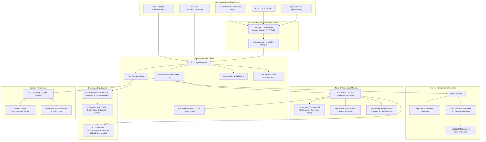
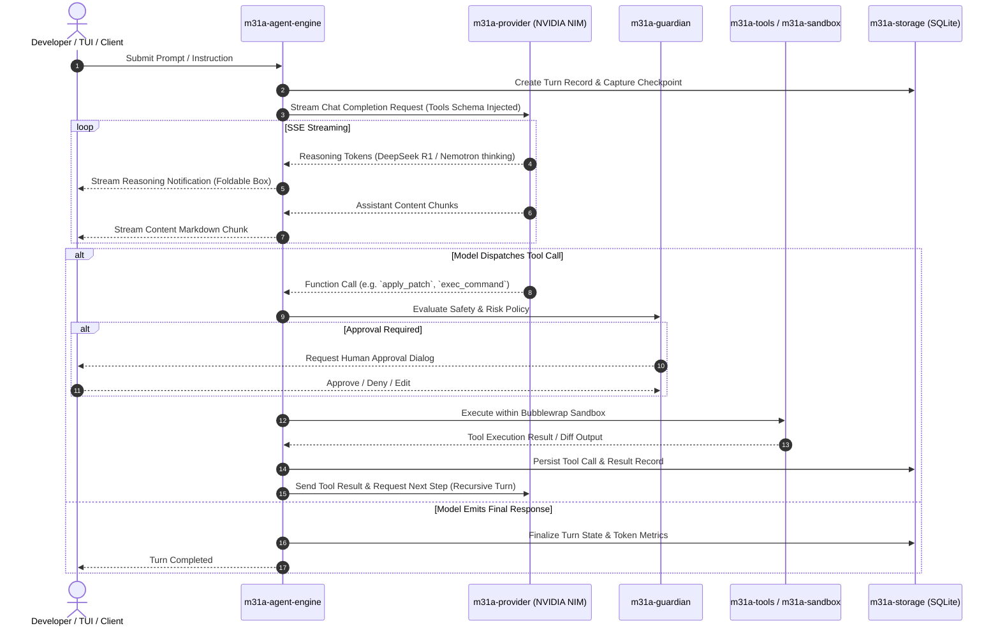

# M31A System Architecture

This document describes the architectural foundations, component interactions, and execution pipelines of **M31A**.

---

## 1. High-Level System Architecture

M31A is engineered as a decoupled, layered Rust 2024 workspace. The architecture separates user-facing interaction channels from the core autonomous agent loop, sandboxed execution runtime, and model inference pipelines.



---

## 2. Core Execution Pipeline: The Multi-Turn Agent Loop

The multi-turn agent loop is orchestrated by `m31a-agent-engine::TurnEngine`:



---

## 3. Autonomous Vibe Coding & Speculative Arena

### Autonomous Vibe Coding Loop (`m31a vibe`)
The vibe loop is a zero-babysitter auto-healing loop:
1. **Filesystem Observation (`m31a-watcher`)**: Monitors workspace files using inotify/kqueue with debounced change detection.
2. **Background Verification (`m31a-verify`)**: Immediately runs compiler, linter, or typechecks (`cargo check`, `tsc`, `pytest`).
3. **Targeted Patch Synthesis**: When errors are detected, a specialized low-latency NIM model (`nvidia/nemotron-3.5-bolt-e4b`) synthesizes targeted multi-file Codex patches.
4. **Self-Healing Verification**: Applies the patch inside the sandbox and confirms the build passes before committing the change.

### Speculative Parallel Reality Arena (`m31a speculate`)
Evaluates competing implementation hypotheses concurrently:
1. Spawns isolated sandbox worktrees for each candidate hypothesis.
2. Concurrently directs models to implement each solution variant.
3. Runs an automated scoring matrix:
   - Compilation and linter status (Binary pass/fail).
   - Test suite pass rate and edge-case resilience.
   - Execution benchmark performance.
   - Blast-radius and semantic safety score (0-100).
4. Automatically selects and merges the winning candidate branch into the working tree.

---

## 4. Codex Multi-File Patch Engine & 4-Tier Fuzzy Seek

M31A implements full OpenAI Codex patch compatibility (`m31a-patch`):

```
*** Begin Patch
*** Update File: src/main.rs
@@ -10,4 +10,5 @@
- println!("Starting...");
+ tracing::info!("Initializing M31A engine...");
*** End Patch
```

### 4-Tier Fuzzy Matching Sequence (`seek_sequence`)
To guarantee high resilience against minor whitespace or formatting deviations, the patch engine resolves context targets through four fallback tiers:
1. **Tier 1 (Exact Match)**: Byte-for-byte exact equality.
2. **Tier 2 (Right-Strip Whitespace)**: Trailing tabs and spaces ignored on each line.
3. **Tier 3 (Full Trim)**: Leading and trailing indentation differences tolerated.
4. **Tier 4 (Unicode Typographic Normalization)**: Transliterates curly quotes, em-dashes, en-dashes, and non-breaking spaces into ASCII equivalents.

---

## 5. Security & Isolation Architecture

M31A enforces defense-in-depth across every workspace action:

### Bubblewrap Namespaces (`m31a-sandbox`)
- Unshares `PID`, `IPC`, `UTS`, and `Mount` namespaces.
- Mounts host root filesystem strictly read-only (`ro-bind / /`).
- Mounts `/dev`, `/proc`, and standard tempfs buffers in unprivileged mode.
- Mounts workspace directory read-write only when authorized.
- Imposes **Read-Only Protection Masks** over sensitive subpaths:
  - `.git/` (protects repo history from tampering)
  - `.m31a/` and `.codex/` (protects agent configurations)
  - `.ssh/` and `~/.ssh` (protects credentials)
  - `.env`, `.env.*`, `*.key`, `*.pem` (protects secrets)

### ExecPolicy & Network Filtering (`m31a-execpolicy`)
- AST token pattern matching classifies CLI commands into `allow`, `prompt`, or `deny`.
- Network destination rules restrict socket access by destination domain, IP, and port.

### Guardian Circuit Breaker (`m31a-guardian`)
- Sliding-window anomaly detection trips into fail-closed lock mode if multiple destructive actions occur within a narrow window (`MAX_DENIALS_BEFORE_TRIP = 3` out of 5 consecutive actions).

---

## 6. App Server Daemon & JSON-RPC 2.0 (`m31a-app-server`)

The application server daemon decouples the core engine from external client frontends (such as IDE extensions and headless CI runners).
- Supports 3 transport protocols:
  - **Stdio**: Standard input/output for direct child process orchestration.
  - **Unix Domain Socket (UDS)**: Local high-throughput IPC at `~/.m31a/app-server-control/app-server-control.sock`.
  - **HTTP with Server-Sent Events (SSE)**: For remote cloud and web clients.
- Fully standardized JSON-RPC 2.0 protocol with bi-directional notifications.

---

## 7. Storage Engine & Multi-Agent Board (`m31a-storage`)

State is persisted within an embedded SQLite database (`m31a.db`):
- **Threads & Turns**: Complete conversation tree including turn items, prompt tokens, completion tokens, and model configurations.
- **Checkpoints**: Atomic workspace snapshots linked to git commits and file change lists.
- **Multi-Agent Message Board**: Pub-sub topic channels enabling autonomous agents in a swarm to share status updates, findings, and requests.
- **Path Concurrency Locks**: Granular file-path mutexes preventing conflicting writes between parallel subagents.
