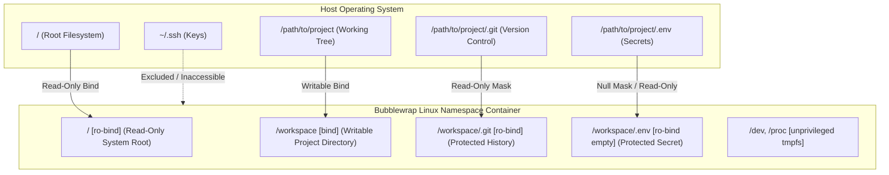

# M31A Sandbox & Security Architecture

Autonomous coding assistants possess the ability to generate code, write files, and dispatch shell commands. Without strict containment, an autonomous loop could accidentally overwrite repository history, leak credentials, or execute destructive commands.

**M31A** enforces a multi-layered defence-in-depth architecture designed to isolate execution, protect credentials, and guard system integrity.

---

## 1. Threat Model

M31A protects against three primary risk vectors:

1. **Accidental Repository / Environment Tampering**: Unintended deletion of `.git` directories, corruption of parent file trees, or unintended process killing.
2. **Credential & Secret Exfiltration**: Untrusted code or prompt injection reading sensitive developer files (`~/.ssh`, `.env`, API keys) and transmitting them over outbound network sockets.
3. **Runaway Autonomous Execution**: Endless loops of destructive mutating commands generated by hallucinating or failing model agents.

---

## 2. Layer 1: Bubblewrap Linux Sandbox (`m31a-sandbox`)

On Linux hosts, M31A executes all tool commands and code builds inside an unprivileged sandbox powered by **Bubblewrap** (`bwrap`).



### Linux Namespace Isolation
- **PID Namespace**: Subprocesses inside the sandbox cannot inspect or terminate host processes.
- **IPC Namespace**: POSIX message queues and SysV shared memory segments are isolated.
- **UTS Namespace**: Hostname and domain name changes inside the sandbox do not affect the host.
- **Mount Namespace**: All filesystem bindings are contained strictly within the container.

### Read-Only Protection Masks
Even when `workspace-write` policy is enabled, M31A automatically applies read-only masks over sensitive subpaths:
- `<workspace>/.git/`: Prevents agents from corrupting commit history, hooks, or object stores.
- `<workspace>/.m31a/` and `<workspace>/.codex/`: Protects agent configuration and session logs.
- `<workspace>/.env` and `<workspace>/.env.*`: Protects API keys and environment secrets.
- `~/.ssh` and `~/.gnupg`: Completely excluded from sandbox visibility.

### Air-Gapped Network Namespace (`--unshare-net`)
When the air-gapped security preset or `--sandbox read-only` is active, M31A invokes Bubblewrap with `--unshare-net`, isolating the network namespace and disabling all outbound network traffic from sandboxed processes.

---

## 3. Layer 2: Prefix & AST ExecPolicy Engine (`m31a-execpolicy`)

Before any shell command is dispatched to the sandbox, it is evaluated by the **ExecPolicy** engine:

### Pattern Rules & Token Matching
ExecPolicy tokenizes commands and applies prefix pattern matching rules with support for alternative tokens (`PatternToken::Alts`):

```toml
# Example ExecPolicy rule
[[rules]]
name = "Package managers install"
pattern = ["npm", "pnpm", "yarn", "install"]
decision = "prompt"
rationale = "Installing external packages modifies node_modules and package-lock"

[[rules]]
name = "Destructive file removal"
pattern = ["rm", "-rf", "/"]
decision = "deny"
rationale = "Attempted destructive root deletion"
```

### Network Destination Filtering
ExecPolicy restricts network sockets created during command execution:
- Allows explicitly whitelisted package registries (e.g., `crates.io`, `npmjs.org`).
- Blocks connections to private LAN IPs (`192.168.0.0/16`, `10.0.0.0/8`, `127.0.0.1`) unless explicitly permitted.

### Tri-State Decision Engine
Every evaluated command resolves to one of three states:
- `allow`: Command is safe and dispatches immediately without user intervention.
- `prompt`: Command is potentially mutating or accesses network; requires human confirmation or Guardian approval.
- `deny`: Command violates security policy and is aborted immediately with explanatory feedback returned to the model.

---

## 4. Layer 3: Guardian Autonomous Supervisor (`m31a-guardian`)

The **Guardian** is an autonomous safety reviewer acting as a circuit breaker for autonomous and vibe coding loops:

### Sliding-Window Anomaly Circuit Breaker
If an autonomous agent repeatedly produces actions that fail security verification or trigger policy denials, the Guardian's sliding-window circuit breaker trips:
- Window Size: `AUTO_REVIEW_DENIAL_WINDOW_SIZE = 5` actions.
- Threshold: `MAX_DENIALS_BEFORE_TRIP = 3` denials.
- Behavior: Immediately freezes autonomous execution, halts the vibe loop, and requires human intervention to unlock.

---

## 5. Layer 4: Hardened Local Proxy (`responses-proxy`)

When storing API credentials, M31A leverages a memory-locked proxy architecture:
- Encryption keys and API tokens are locked in RAM with `mlock(2)` to prevent paging to disk.
- Tokens are automatically scrubbed from memory buffers on deallocation.

---

## 6. Cross-Platform Sandbox Backends (`m31a-sandbox`)

M31A enforces platform-native sandbox boundaries through a unified fail-closed abstraction (`SandboxPlatform`):

### macOS Seatbelt Backend (`sandbox-exec`)
On macOS hosts, M31A generates dynamic Scheme-based Seatbelt Profiles (`.sb` / SBPL):
- **Version 1 Profile Header**: `(version 1) (deny default)`
- **Network Isolation**: When `ReadOnly` or air-gapped execution is requested, network operations (`network-outbound`, `network-inbound`) are explicitly denied. In `WorkspaceWrite` mode, network is selectively permitted if configured by policy.
- **Filesystem Boundaries**: System binaries (`/usr`, `/bin`, `/System`, `/Library`, `/dev`) are granted read-only access. Write permissions are scoped strictly to the authorized workspace and temporary directories (`/private/tmp`, `/var/folders`).
- **Path Escaping**: All literal paths are sanitized and escaped against SBPL parenthesis/quote injection attacks.
- **Fail-Closed Guarantee**: If `sandbox-exec` is missing or fails to compile the profile, command dispatch is terminated immediately with an actionable error.

### Windows AppContainer Isolation Backend
On Windows hosts, M31A isolates unprivileged commands inside native Windows AppContainers:
- **Restricted Process Identity**: Processes run with a low-integrity AppContainer token and dedicated container SID.
- **Explicit DACL Grants**: Ambient access to user profiles, credentials (`%USERPROFILE%\.ssh`, `%USERPROFILE%\.aws`), and other drives is blocked. Writable access is granted exclusively to the active workspace directory using `icacls` grants for the container SID.
- **Network Isolation**: Outbound network traffic requires explicit capability grants (`internetClient`); in `ReadOnly` isolation mode, all network capabilities are omitted.
- **Fail-Closed Dispatch**: M31A does not substitute normal Job Objects or standard tokens for an AppContainer. If AppContainer creation fails, the command is aborted fail-closed.

---

## 7. Kernel-Level Observational Auditing (`m31a-ebpf`)

M31A complements userspace sandbox enforcement with Linux kernel-level execution observation:

### Security Boundary: Auditing vs. Enforcement
> [!IMPORTANT]
> **Auditing is strictly observational.** `m31a-ebpf` does not act as an alternative security policy engine. Authoritative security enforcement remains the sole responsibility of `m31a-sandbox` (Bubblewrap namespaces, Landlock, Seccomp) and `m31a-execpolicy`. If eBPF tracing is unavailable (e.g., due to `/proc/sys/kernel/unprivileged_bpf_disabled = 2`), sandboxed execution proceeds securely with an explicit `AuditDegraded` status report rather than failing closed.

### Provenance & Lifecycle Tracing
- **Process Lineage**: Observes `sys_enter_execve`, `sys_enter_clone`, `sys_enter_fork`, and `sys_enter_exit` to construct full child-process trees mapped back to the originating sandbox turn.
- **Syscall Auditing**: Traces `openat`, `unlinkat`, `connect`, and execution attempts.
- **Secret Redaction**: Redacts high-entropy API tokens (`nvapi-`, `ghp_`, `sk-`), command flags (`--token=`, `--password=`), and sensitive paths (`.ssh`, `.env`) before recording audit events.
- **Bounded Ring Buffer Metrics**: Real-time atomic counters track dropped events (`dropped_records`) during kernel ring buffer congestion.
- **Empirically Measured Overhead**: Sub-microsecond dispatch overhead per audited record (~20-40 ns), verified with reproducible benchmarks.

---

## 8. Sandboxed WebAssembly Extension Runtime (`m31a-wasm`)

Extensions and plugins in M31A are isolated in a memory-safe WebAssembly runtime:
- **Pure-Rust Deterministic Runtime**: Powered by `wasmi` with zero native JIT code generation risks.
- **Fuel Metering**: Guest execution is bounded by explicit fuel quotas (e.g. 5,000,000 instructions) preventing infinite loops and denial-of-service attacks.
- **Linear Memory Sandboxing**: Guest linear memory is strictly bounded (e.g. 16 pages = 1 MiB) with checked read/write bounds enforcement.
- **Capability Gating**: Ambient filesystem and network access are denied. Guest modules can only invoke host functions explicitly declared in their signed manifest and granted at runtime.
- **ABI Coexistence**: WebAssembly extensions coexist transparently with native C ABI extensions (`m31a-extension-api`) behind a unified capability model.
