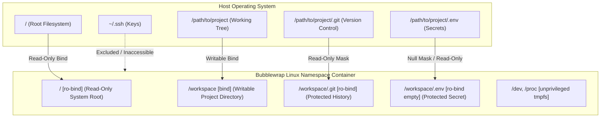

# M31A Sandbox & Security Architecture

Autonomous coding assistants possess the ability to generate code, write files, and dispatch shell commands. Without strict containment, an autonomous loop could accidentally overwrite repository history, leak credentials, or execute destructive commands.

**M31A** enforces a multi-layered defence-in-depth architecture designed to isolate execution, protect credentials, and guard system integrity.

---

## 1. Threat Model

M31A protects against three primary risk vectors:

1. **Accidental Repository / Environment Tampering**: Unintended deletion of `.git` directories, corruption of parent file trees, or unintended process killing.
2. **Credential & Secret Exfiltration**: Untrusted code or prompt injection reading sensitive developer files (`~/.ssh`, `.env`, API keys) and transmitting them over outbound network sockets.
3. **Runaway Autonomous Execution**: Endless loops of destructive mutating commands generated by hallucinating or failing model agents.

---

## 2. Layer 1: Bubblewrap Linux Sandbox (`m31a-sandbox`)

On Linux hosts, M31A executes all tool commands and code builds inside an unprivileged sandbox powered by **Bubblewrap** (`bwrap`).



### Linux Namespace Isolation
- **PID Namespace**: Subprocesses inside the sandbox cannot inspect or terminate host processes.
- **IPC Namespace**: POSIX message queues and SysV shared memory segments are isolated.
- **UTS Namespace**: Hostname and domain name changes inside the sandbox do not affect the host.
- **Mount Namespace**: All filesystem bindings are contained strictly within the container.

### Read-Only Protection Masks
Even when `workspace-write` policy is enabled, M31A automatically applies read-only masks over sensitive subpaths:
- `<workspace>/.git/`: Prevents agents from corrupting commit history, hooks, or object stores.
- `<workspace>/.m31a/` and `<workspace>/.codex/`: Protects agent configuration and session logs.
- `<workspace>/.env` and `<workspace>/.env.*`: Protects API keys and environment secrets.
- `~/.ssh` and `~/.gnupg`: Completely excluded from sandbox visibility.

### Air-Gapped Network Namespace (`--unshare-net`)
When the air-gapped security preset or `--sandbox read-only` is active, M31A invokes Bubblewrap with `--unshare-net`, isolating the network namespace and disabling all outbound network traffic from sandboxed processes.

---

## 3. Layer 2: Prefix & AST ExecPolicy Engine (`m31a-execpolicy`)

Before any shell command is dispatched to the sandbox, it is evaluated by the **ExecPolicy** engine:

### Pattern Rules & Token Matching
ExecPolicy tokenizes commands and applies prefix pattern matching rules with support for alternative tokens (`PatternToken::Alts`):

```toml
# Example ExecPolicy rule
[[rules]]
name = "Package managers install"
pattern = ["npm", "pnpm", "yarn", "install"]
decision = "prompt"
rationale = "Installing external packages modifies node_modules and package-lock"

[[rules]]
name = "Destructive file removal"
pattern = ["rm", "-rf", "/"]
decision = "deny"
rationale = "Attempted destructive root deletion"
```

### Network Destination Filtering
ExecPolicy restricts network sockets created during command execution:
- Allows explicitly whitelisted package registries (e.g., `crates.io`, `npmjs.org`).
- Blocks connections to private LAN IPs (`192.168.0.0/16`, `10.0.0.0/8`, `127.0.0.1`) unless explicitly permitted.

### Tri-State Decision Engine
Every evaluated command resolves to one of three states:
- `allow`: Command is safe and dispatches immediately without user intervention.
- `prompt`: Command is potentially mutating or accesses network; requires human confirmation or Guardian approval.
- `deny`: Command violates security policy and is aborted immediately with explanatory feedback returned to the model.

---

## 4. Layer 3: Guardian Autonomous Supervisor (`m31a-guardian`)

The **Guardian** is an autonomous safety reviewer acting as a circuit breaker for autonomous and vibe coding loops:

### Sliding-Window Anomaly Circuit Breaker
If an autonomous agent repeatedly produces actions that fail security verification or trigger policy denials, the Guardian's sliding-window circuit breaker trips:
- Window Size: `AUTO_REVIEW_DENIAL_WINDOW_SIZE = 5` actions.
- Threshold: `MAX_DENIALS_BEFORE_TRIP = 3` denials.
- Behavior: Immediately freezes autonomous execution, halts the vibe loop, and requires human intervention to unlock.

---

## 5. Layer 4: Hardened Local Proxy (`responses-proxy`)

When storing API credentials, M31A leverages a memory-locked proxy architecture:
- Encryption keys and API tokens are locked in RAM with `mlock(2)` to prevent paging to disk.
- Tokens are automatically scrubbed from memory buffers on deallocation.
