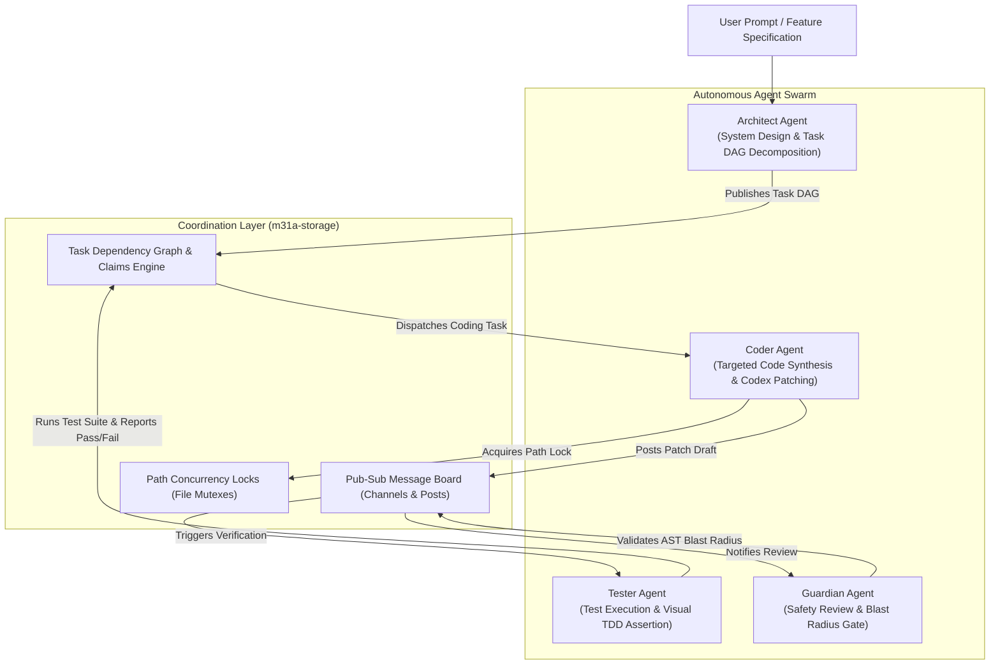

# Multi-Agent Swarms & Distributed Task Coordination

Complex software engineering tasks often exceed the capabilities of a single monolithic agent turn. **M31A** implements a multi-agent orchestration architecture featuring role specialization, cross-agent communication channels, and path-based concurrency control.

---

## 1. Multi-Agent Swarm Architecture

The **M31A Swarm** (`m31a swarm`) decomposes large engineering objectives across a coordinated team of autonomous agents:



---

## 2. Specialized Agent Roles

1. **The Architect (`role: Architect`)**:
   - Analyzes high-level requirements and examines the workspace structure.
   - Decomposes the task into an acyclic Dependency Graph (DAG) with explicit milestone verification checkpoints.
   - Assigns subtasks to specialized coder agents.

2. **The Coder (`role: Coder`)**:
   - Acquires path concurrency locks for target files.
   - Generates minimal, precise multi-file patches adhering to the Codex patch specification.
   - Applies changes inside the Bubblewrap sandbox.

3. **The Tester (`role: Tester`)**:
   - Executes workspace compilers (`cargo check`, `tsc`, `pytest`).
   - Runs integration test suites and benchmarks.
   - For web frontends, invokes the headless Chromium visual TDD engine (`m31a-browser`) to assert DOM state and screenshot captures.

4. **The Guardian (`role: Guardian`)**:
   - Audits proposed patches against the semantic blast-radius gate (0-100 score).
   - Verifies intra-procedural data-flow taint invariants to ensure untrusted inputs do not flow into security-critical sinks.

---

## 3. Communication: The Agent Message Board

Agents coordinate asynchronously using an embedded SQLite pub-sub message board (`m31a-storage`):

### Topic Channels
- `#architecture`: High-level system design decisions and task decomposition DAGs.
- `#workspace`: Active patch proposals and file modification announcements.
- `#testing`: Test output logs, compiler diagnostics, and visual regression diffs.
- `#blockers`: Deadlock notifications or ambiguous requirements requiring clarification.

### Board CLI & RPC Operations
```bash
# Inspect recent message board activity
m31a board list

# Post an update to a specific channel
m31a board post architecture "Refactored m31a-patch to use SIMD character scanners"
```

---

## 4. Concurrency: Granular Path-Based Locks

To prevent race conditions when multiple subagents modify the same codebase in parallel:
- An agent must acquire a path lock (`locks/acquire`) before writing to any file.
- Path locks support hierarchical parent/child checks (e.g. acquiring `crates/m31a-patch/` locks all subpaths).
- Locks feature automatic timeouts and dead-agent cleanup.

---

## 5. Distributed Task Mesh

For distributed or cluster-wide agent coordination, M31A includes a reference architecture in [`examples/distributed_task_mesh`](file:///home/snigdha/Desktop/org.m31a/examples/distributed_task_mesh):
- Features Write-Ahead Log (WAL) replication across nodes.
- Heartbeat cluster discovery and consensus scheduling.
- Parallel task execution across multiple machines or cloud worker instances.
