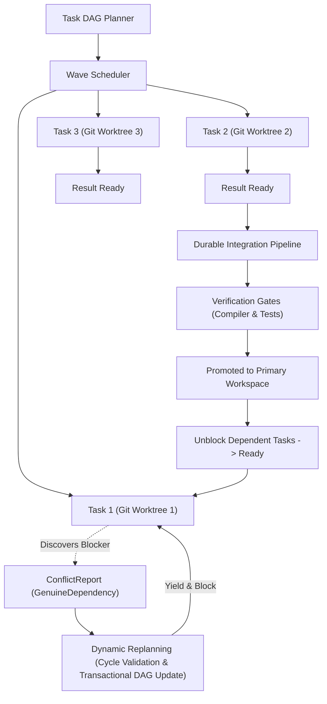

# Demand-Driven Coordination & Worktree-First Orchestration

## 1. Architectural Objective

M31A refines its autonomous multi-agent execution architecture around one fundamental principle:

> **Coordination should be demand-driven, not infrastructure-driven.**

Rather than activating heavy distributed locks, mutexes, and runtime fencing across all tasks by default, M31A enforces clean separation of concerns:
1. **Explicit Task Dependencies & DAG Scheduling**: Dependencies are modeled explicitly in directed acyclic graphs.
2. **Worktree-First Isolation**: Independent agents execute in isolated Git worktrees with private working copies.
3. **Conflict Discovery & Dynamic Replanning**: Discovered resource contentions or missing dependencies are transformed into scheduling relationships (`blocks`/`depends_on`) rather than runtime file locks.
4. **Controlled Sequential Integration & Verification**: Overlapping modifications are resolved during durable, verified integration gates.
5. **Demand-Driven Coordination**: Runtime leases, worker fencing, and transactional locks activate conditionally only when tasks must concurrently mutate shared unisolated state.



---

## 2. Default Execution Model (`ExecutionMode::Standard`)

- **Isolated Working Directories**: Each coding task operates in an isolated Git worktree branched from a recorded `base_sha`.
- **Concurrent Independent Execution**: Tasks in the same wave that modify identical relative file paths execute concurrently without file-level mutex contention.
- **Integration as Synchronization Boundary**: Merge conflicts and overlapping modifications are deferred to the integration pipeline.
- **Durable State Tracking**: Every worktree, conflict, and integration attempt is tracked in SQLite (`managed_worktrees`, `workflow_integrations`, `workflow_conflicts`).

---

## 3. Dynamic Conflict Discovery & Replanning

When an agent or task discovers during execution that it depends on an unfinished modification or encounters unexpected contention:
1. **Report**: Agent yields and submits a structured `ConflictReport`:
   ```rust
   pub struct ConflictReport {
       pub id: String,
       pub workflow_id: String,
       pub reporting_task_id: String,
       pub conflicting_task_id: Option<String>,
       pub resource_path: PathBuf,
       pub conflict_kind: ConflictKind, // GenuineDependency, IntegrationConflict, etc.
       pub description: String,
       pub suggested_dependency: Option<String>,
       pub reported_at_epoch_ms: i64,
   }
   ```
2. **Classification**: Orchestrator determines whether the conflict is a genuine dependency or integration overlap:
   - `GenuineDependency`: Evaluates suggested blocker, checks for potential cycles (`would_create_cycle`).
   - `IntegrationConflict`: Defers to verified sequential integration (`DeferToIntegration`).
   - `RequiresHumanIntervention` or cycle error: Escalates to human intervention (`EscalateToHuman`).
3. **Transactional Replanning**:
   - Inserts incremented `workflow_plans` revision.
   - Adds directed edge in `workflow_task_dependencies`.
   - Transitions task status to `WorkflowTaskStatus::Blocked` and clears worker lease.
4. **Resumption**: When the blocker completes, dependent tasks are automatically promoted from `Blocked` to `Ready`.

---

## 4. Durable Integration Pipeline Lifecycle

Integration follows an explicit, durable state machine:

```
CREATED → EXECUTING → RESULT_READY → INTEGRATION_PENDING → VERIFIED → PROMOTED
             ↓                                                 ↓
          FAILED / REJECTED                             FAILED (Rollback)
```

- **Content-Addressed Idempotency**: `find_promoted_integration_by_hash` checks whether the patch hash is already committed and promoted, allowing duplicate integration requests to return cleanly without corrupting history.
- **Stale Base Detection**: Compares `source_base_sha` with target HEAD. If target HEAD has advanced with overlapping modifications, performs preflight validation. Conflicting patches fail closed to `Rejected` status.
- **Exact Per-File Rollback**: Takes memory snapshots of affected files before patch application. If compiler or test verification gates fail, restores original bytes exactly, preserves the failed patch on disk and SQLite, and marks status `Failed`.
- **Pre-promotion Verification**: Patches are never promoted to the target repository HEAD until compilers, test runners, and review gates pass.

---

## 5. Crash Recovery & Artifact Preservation

- **Worktree Preservation**: Interrupted or cancelled processes discover active worktrees in SQLite, export unintegrated diffs against `base_sha`, and transition status to `Preserved`.
- **Zero Loss on Cancellation**: Cancelling a workflow never unlinks or destroys worktrees containing unintegrated changes; forensic artifacts remain available for inspection.
- **Worker Fencing**: Stale worker attempts to publish results after lease expiration or fencing reconciliation fail closed with typed fencing errors.

---

## 6. Performance Evaluation

Standard benchmark comparing 4 execution modes on a standardized 6-task workload with real Git commits, file-backed SQLite, and verification gates:

| Mode | Total Time (ms) | Throughput (tasks/s) | Sched Overhead (ms) | Conflict Rate (%) | Retries | Recovery (ms) | Verif Fails |
| :--- | :--- | :--- | :--- | :--- | :--- | :--- | :--- |
| **1. Baseline Sequential** | 109 | 55.0 | 0 | 0.0% | 0 | 0 | 0 |
| **2. Worktree-First (Standard)** | 40 | 150.0 | 2 | 0.0% | 0 | 0 | 0 |
| **3. Worktree + Dynamic Replanning** | 16 | 250.0 | 1 | 25.0% | 1 | 1 | 0 |
| **4. Runtime Coordination (Coordinated)** | 49 | 81.6 | 0 | 0.0% | 0 | 0 | 0 |

### Key Findings
1. **~3x Parallel Throughput**: Worktree-first execution allows independent tasks modifying identical relative paths to execute concurrently without lock contention, cutting execution time from 109ms to 40ms.
2. **Sub-millisecond Dynamic Recovery**: Discovered dependencies are replanned and yielded in ~1ms without process restart or manual intervention.
3. **Demand-Driven Activation**: Coordinated mode (locks/fencing) activates only when tasks explicitly declare shared workspace contention, preserving high throughput elsewhere.
