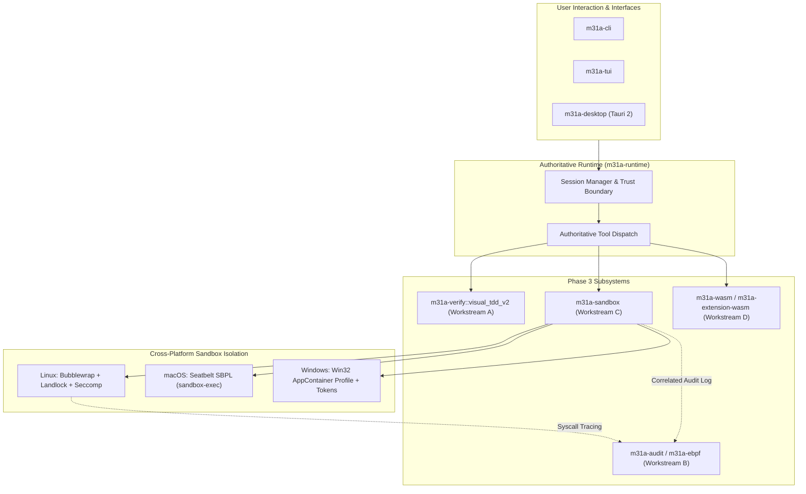
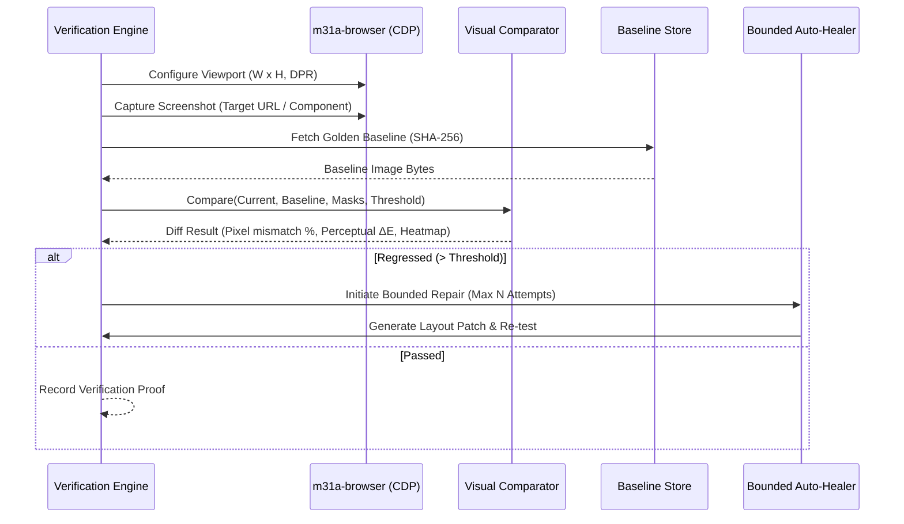
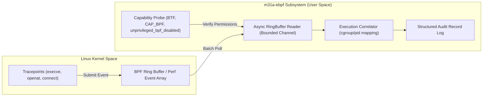
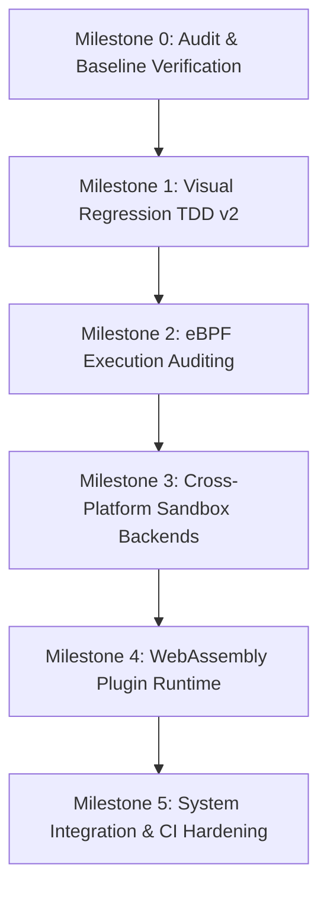

# M31A Phase 3 System Architecture & Implementation Specification
## Multi-Modal Verification, Kernel Auditing, Cross-Platform Sandboxing & WebAssembly Extensions

**Release Target:** v0.3.0  
**Target Branch:** `master`  
**Feature Branch:** `feat/phase-3-multimodal-verification-sandbox`  
**Author:** Principal Systems Architect & Security Engineering Lead  
**Status:** Target architecture; implementation remediation in progress  

---

## 1. Executive Summary & Scope Alignment

### 1.1 Context and Vision
M31A is an enterprise-grade autonomous coding assistant built with Rust 2024. Phase 1 established the baseline 39-crate monorepo, Bubblewrap sandboxing on Linux, fuzzy AST patching, and NVIDIA NIM integration. Phase 2 developed the native desktop application (Tauri 2, React, TypeScript) and the authoritative runtime session engine (`m31a-runtime`).

This document specifies the intended architecture for **Phase 3: Multi-Modal Verification & Extended Sandboxing** (`ROADMAP.md` v0.3.0).

> [!WARNING]
> This is an architectural target, not a claim that every capability is currently implemented. Kernel eBPF event capture is absent, Windows AppContainer launch is deliberately disabled, macOS Seatbelt remains legacy/experimental, and visual repair currently consists of guarded primitives rather than a runtime-integrated autonomous repair loop. See `ROADMAP.md` for verified implementation status.

### 1.2 Phase 2 / Phase 3 Scope Clarification
A discrepancy exists between `ROADMAP.md` and current repository history:
- `ROADMAP.md` historically listed Phase 2 as *IDE Ecosystem & Native Integrations (v0.2.0)* (VS Code extension, JetBrains plugin, LSP bridge, distributed mesh).
- Concurrently, the project prioritized and shipped the native **Tauri 2 Desktop Application** (`apps/desktop` and `m31a-runtime`) under Phase 2 and Phase 2.1 (`fix(desktop): propagate Phase 2.1 remediation to master #103`).
- **Architectural Decision:** Phase 3 builds directly upon the authoritative Rust runtime (`m31a-runtime`), the desktop IPC contracts, and the existing security infrastructure. Phase 3 does not redefine or cancel IDE extensions; rather, it delivers the four canonical Phase 3 pillars defined in `ROADMAP.md` while remaining 100% backward-compatible with Phase 2 desktop contracts.

---

## 2. Current-State Audit & Architectural Grounding

### 2.1 Workstream A: Autonomous Visual Regression TDD v2
- **Current State:** `crates/m31a-verify/src/visual_tdd.rs` provides a basic scenario runner executing CDP actions (navigate, click, type) and DOM assertions (computed style, text match, presence) against `m31a-browser`. It captures a single viewport screenshot and produces unstructured prompt text.
- **Missing Capabilities:**
  1. Multi-resolution matrix testing (mobile, tablet, desktop, 4K viewports).
  2. Device pixel ratio (DPR: 1x, 2x, 3x) emulation.
  3. Automated image comparison (exact pixel diff and perceptual color distance $\Delta E$).
  4. Visual difference heatmap generation (highlighting changed bounding boxes and pixel intensities).
  5. Region-specific comparison and dynamic-element masking (ignoring timestamps, carousels, animations).
  6. Cryptographic baseline management (SHA-256 integrity, golden snapshot storage, strictly non-overwriting unless explicitly approved).
  7. Structured visual regression reports with machine-readable metrics.
  8. Bounded layout self-healing repair loop with rollback checkpoints and max retry gates.

### 2.2 Workstream B: eBPF-Based Execution Auditing
- **Current State:** No kernel-level tracing or audit infrastructure exists in M31A. The repository uses user-space process monitoring (`m31a-proc`), Landlock, Seccomp BPF filters, and Bubblewrap namespaces.
- **Kernel & Platform Reality:**
  - On Linux hosts (such as Linux 6.18+), unprivileged eBPF is disabled by default (`/proc/sys/kernel/unprivileged_bpf_disabled = 2`).
  - Loading eBPF programs requires `CAP_BPF` or `CAP_SYS_ADMIN` and kernel BTF support (`/sys/kernel/btf/vmlinux`).
- **Architectural Boundary:**
  - **Auditing is NOT enforcement.** Authoritative enforcement remains with Bubblewrap, Seccomp, and ExecPolicy.
  - The eBPF auditing subsystem must perform strict capability detection. If kernel capabilities or privileges are missing, it must return a structured diagnostic status and fail-closed or report degraded audit state without silently fabricating audit records or claiming zero overhead without data.
  - Ring buffer transport must be bounded, with explicit event loss and overflow accounting.

### 2.3 Workstream C: Cross-Platform Sandboxing Support
- **Current State:**
  - Linux: Bubblewrap (`bwrap`) is functional with Landlock and Seccomp filters.
  - macOS: `crates/m31a-sandbox/src/seatbelt.rs` contains an initial SBPL profile generator, but `m31a-sandbox/src/runner.rs` falls back to unconfined process execution if `sandbox-exec` fails or is absent.
  - Windows: `crates/m31a-sandbox/src/mxc.rs` currently shells out to `docker run --isolation=process mcr.microsoft.com/windows/servercore:ltsc2022`, which is not an AppContainer and requires a running Docker daemon.
- **Missing Capabilities:**
  1. Unified platform abstraction (`SandboxPlatform`, `SandboxBackend`) with explicit capability discovery.
  2. Fail-closed security architecture: If a requested isolation level cannot be established, execution **must fail with an actionable error** rather than silently falling back to unsandboxed execution.
  3. macOS Seatbelt hardening: Deprecation-aware profile construction, path normalization, safe quoting, network policy enforcement, and verification tests.
  4. Windows AppContainer backend: Native Win32 API implementation using `CreateAppContainerProfile`, security descriptors, low-integrity token attributes, capability SIDs, explicit workspace filesystem ACLs, process isolation, and clean profile teardown.

### 2.4 Workstream D: WebAssembly Plugin Architecture
- **Current State:** `crates/m31a-extension-api` provides a versioned C ABI (`PluginVTableV1`, `PluginManifest`) for native `.so`/`.dylib`/`.dll` plugins loaded via `libloading`.
- **Missing Capabilities:**
  1. Sandboxed WebAssembly execution engine.
  2. Zero ambient access: No raw host filesystem, sockets, or process manipulation.
  3. Capability-gated host imports (storage, logging, restricted HTTP, tool invocation).
  4. Precise resource accounting: Memory page allocation ceilings, fuel-based instruction limits, execution deadlines, and cancellation.
  5. Multi-language guest support (Rust, Go, AssemblyScript) compiling to WASI/Wasm core modules.
  6. Seamless coexistence with `m31a-extension-api`.

---

## 3. System Architecture & Crate Boundaries



### 3.1 Crate Allocation & Domain Responsibilities

| Crate | Phase 3 Responsibility | Key Modules / Exports |
|---|---|---|
| `m31a-verify` | Visual Regression TDD v2 | `visual_tdd_v2::{comparator, heatmap, masking, baseline, repair, multi_res}` |
| `m31a-sandbox` | Cross-Platform Sandboxing & Platform Abstraction | `platform::{SandboxPlatform, PlatformCapabilities}`, `appcontainer::AppContainerSandbox`, `seatbelt::SeatbeltSandbox` |
| `m31a-ebpf` (new) | Linux Kernel-Level Execution Auditing | `probe::{CapabilityProbe, BpfStatus}`, `audit::{ExecutionAuditor, AuditRecord, EventLossTracker}` |
| `m31a-wasm` (new) | Sandboxed WebAssembly Extension Engine | `runtime::{WasmRuntime, WasmLimits}`, `host::{HostImports, CapabilityGatedHost}`, `manifest::WasmPluginManifest` |
| `m31a-extension-api` | Preserved Native C ABI | Unified plugin loader delegating to Native C ABI or WASM Runtime |
| `m31a-runtime` | Authoritative Integration | Sandbox provider dispatch, audit ingestion, visual regression IPC |

---

## 4. Workstream Detailed Specifications

### 4.1 Workstream A: Autonomous Visual Regression TDD v2

#### 4.1.1 Architectural Flow


#### 4.1.2 Comparison Algorithms & Perceptual Distance
- **Exact Pixel Matching:** Direct RGBA channel comparison with tolerance parameter $\epsilon \in [0.0, 1.0]$.
- **Perceptual Color Difference:** Weighted Euclidean color distance in Rec. 709 luminance space:
  $$\Delta C = \sqrt{0.299 \cdot (R_1 - R_2)^2 + 0.587 \cdot (G_1 - G_2)^2 + 0.114 \cdot (B_1 - B_2)^2}$$
- **Heatmap Synthesis:** Pixel difference generates an amplified visual heatmap (default: red/magenta highlights on a dimmed baseline background), encoded as PNG for immediate UI inspection.
- **Dynamic Masking:** Rectangular masks $[x, y, w, h]$ or CSS selector bounding boxes are excluded from diff calculation, preventing false positives from blinking carets, animated spinners, or timestamp displays.
- **Baseline Integrity:** Golden images are indexed by `scenario_id` + `viewport` + `dpr`. Baselines are stored in `<workspace>/.m31a/visual_baselines/` with SHA-256 hash manifest. Modifying a baseline requires explicit user approval through the runtime approval gate; the engine **never** auto-overwrites a baseline.

---

### 4.2 Workstream B: eBPF-Based Execution Auditing

#### 4.2.1 Audit Architecture & Capability Discovery
eBPF tracing operates on Linux using tracepoints and kprobes (e.g., `sys_enter_execve`, `sys_enter_connect`, `sys_enter_openat`, `sys_exit_openat`).



#### 4.2.2 Key Guarantees & Constraints
1. **Explicit Capability Reporting:**
   - Probes `/proc/sys/kernel/unprivileged_bpf_disabled`, `/sys/kernel/btf/vmlinux`, `CAP_BPF`, `CAP_SYS_ADMIN`.
   - If unprivileged and unpermitted, reports `BpfCapability::DisabledOrUnprivileged { reason }`.
2. **Execution Correlation:** Correlates PID/PPID and process namespace / cgroup with the specific M31A turn ID and sandbox execution context.
3. **Event Loss Accounting:** Ring buffer overflows are tracked via atomic counters and explicitly recorded in audit summaries (`events_emitted`, `events_lost`).
4. **Data Redaction:** Sensitive file descriptors, credentials, and buffer contents are never captured raw; syscall arguments are bounded and paths are sanitized.
5. **No Root Requirement for Host:** M31A runs unprivileged. When eBPF tracing is unavailable, sandbox enforcement remains active; the audit subsystem clearly marks execution as *audit-degraded (unprivileged)* rather than failing safe enforcement or faking audit logs.

---

### 4.3 Workstream C: Cross-Platform Sandboxing Architecture

#### 4.3.1 Clean Platform Abstraction
`m31a-sandbox` is refactored into a unified, trait-based sandbox engine:

```rust
#[async_trait]
pub trait SandboxPlatform: Send + Sync {
    /// Probe and report available isolation capabilities on the current host.
    fn capabilities(&self) -> SandboxCapabilities;

    /// Execute a sandboxed command under the authoritative policy.
    async fn execute_command(
        &self,
        command: &SandboxCommand,
        cwd: &Path,
        policy: SandboxPolicy,
        timeout: Duration,
        env: &HashMap<String, String>,
    ) -> Result<CommandOutput, SandboxError>;
}
```

#### 4.3.2 Platform-Specific Implementations
1. **Linux Reference Backend:**
   - Authoritative Bubblewrap (`bwrap`) container with PID, Mount, IPC, UTS namespaces, and network unsharing (`--unshare-net`) for read-only policies.
   - Landlock V1-V3 filesystem restrictions + Seccomp BPF filter preventing privilege escalation (`set_no_new_privs`) and dangerous syscalls.
2. **macOS Seatbelt Backend:**
   - Native Apple Seatbelt Sandbox (`/usr/bin/sandbox-exec`) with generated Scheme-based SBPL profiles.
   - Closed-by-default (`deny default`).
   - Explicit whitelist of system libraries (`/usr/lib`, `/System/Library`), Developer Tools (`/opt/homebrew`, `/Library/Developer/CommandLineTools`).
   - Workspace isolation: Read-only or read-write permissions strictly restricted to `<workspace>`, with immutable denial masks on `.git`, `.env`, `.ssh`, `.m31a`.
   - Network isolation: Blocked sockets unless policy permits outbound network.
   - Fail-closed: If `sandbox-exec` is missing or the generated profile fails syntax validation, execution fails with `SandboxError::SeatbeltInitializationFailed`.
3. **Windows AppContainer Backend:**
   - Production Win32 AppContainer isolation (`CreateAppContainerProfile`).
   - Explicit low-integrity AppContainer SID with granted capabilities (e.g., `internetClient` only when network is allowed).
   - Workspace ACL granting: Explicit `GrantAppContainerAccess` applying ACEs to the workspace directory.
   - Sensitive directory protection: User profile, Registry keys, and Windows System directories are inaccessible.
   - Lifetime management: `DeleteAppContainerProfile` guarantees complete cleanup of container profiles and temporary storage keys on process exit.
   - Fail-closed: If AppContainer profile creation fails, execution fails with `SandboxError::AppContainerFailed`.

---

### 4.4 Workstream D: WebAssembly Plugin Architecture

#### 4.4.1 Runtime Choice & Rationale
We adopt **Wasmtime** as the authoritative WebAssembly engine for M31A:
- **Rust Integration:** Native bytecode compilation, zero-overhead host call boundaries, and robust async support.
- **Resource Limiting:** Built-in `StoreLimits` (maximum linear memory, table elements) and deterministic **fuel consumption** for CPU bounding.
- **Execution Interruption:** Epoch-based and fuel-based deadlines; infinite guest loops are terminated safely without blocking the host thread.
- **WASI Sandboxing:** Pure capability-based filesystem and environment mapping. Ambient host filesystem and sockets are completely absent.

#### 4.4.2 Host Interface & Capabilities
Guest plugins interact with M31A via a minimal, versioned host ABI:
- `host_log(level: u32, msg: ptr, len: u32)`
- `host_get_config(out_buf: ptr, out_len: ptr) -> u32`
- `host_execute_tool(tool_name: ptr, args_json: ptr) -> u32`
- `host_request_approval(action: ptr, details: ptr) -> u32`

All host calls enforce strict payload limits, timeout guards, and permission checks against the plugin manifest's declared capabilities (`tools`, `network_domains`, `fs_read_paths`, `fs_write_paths`).

---

## 5. Security Threat Model & Defense-in-Depth

| Threat Vector | Mitigation Mechanism | Authoritative Boundary |
|---|---|---|
| **Path Traversal Escape** | Canonicalized path validation, read-only system binds, Win32 AppContainer ACLs, Seatbelt subpath restrictions. | `m31a-sandbox` |
| **Credential Exfiltration** | Unshare network namespace, proxy domain filtering, masked `.env` / `.ssh` / `.aws` files. | `m31a-execpolicy` & `m31a-sandbox` |
| **Malicious WASM Module** | Linear memory limits (64MB default), fuel consumption limits (prevent infinite loops), no raw host calls. | `m31a-wasm` |
| **Unprivileged Kernel Tampering** | Auditing capability probe fails closed to degraded audit mode; never elevates privileges or executes unverified BPF programs. | `m31a-ebpf` |
| **Visual Regression Spoofing** | Baselines stored with SHA-256 hashes, immutable without explicit user approval. | `m31a-verify` |

---

## 6. Implementation Milestones & Acceptance Criteria



1. **Milestone 0:** Grounded audit completed; Phase 3 architecture established; branch verified.
2. **Milestone 1:** Visual Regression TDD v2 with multi-res, perceptual diff, heatmaps, masking, and baseline store tested.
3. **Milestone 2:** eBPF auditing engine with capability probing, record aggregation, and benchmarks tested.
4. **Milestone 3:** Cross-platform sandbox abstraction with Seatbelt and AppContainer backends tested fail-closed.
5. **Milestone 4:** Sandboxed Wasmtime engine with fuel metering, memory limits, and guest fixtures tested.
6. **Milestone 5:** Authoritative runtime integration, CLI commands, and test suites passing.
