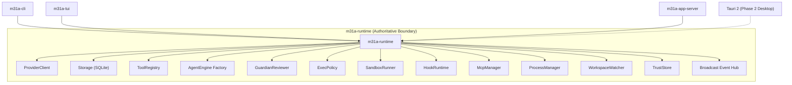

# M31A Runtime Architecture (Phase 1)

## Status

This document describes the Phase 1 boundary introduced by the `m31a-runtime` crate. The runtime is a headless, presentation-independent owner of the services needed by an agent turn. The CLI, TUI, and app-server remain responsible for their existing command syntax, terminal interaction, JSON-RPC envelopes, and transport behavior.

## Goals

- Give every production entry point one authoritative owner for provider, storage, tools, security policy, hooks, MCP, background processes, workspace trust, and child-agent services.
- Keep the runtime independent of TUI, CLI, app-server, JSON-RPC, ratatui, crossterm, and other presentation or terminal types.
- Preserve the existing `AgentEngine` turn contract while making runtime-owned services reusable across turns and surfaces.
- Make cancellation, bounded event delivery, shutdown, and failure reporting explicit and testable.
- Keep authorization, approval, sandboxing, execution policy, and trust enforcement in Rust.

## Non-goals

Phase 1 does not:

- introduce Tauri or another desktop shell;
- remove or redesign the CLI or TUI;
- change the app-server JSON-RPC method names, request/response shapes, notification names, or transport framing;
- replace `AgentEngine` with a new turn-loop implementation;
- move policy decisions into a scripting runtime or expose unrestricted command execution;
- migrate commands that only inspect configuration, trust records, or session history and do not execute an agent turn.

## Dependency direction



```text
m31a-cli
  ├──> m31a-tui
  ├──> m31a-app-server
  └──> m31a-runtime

m31a-tui ────────────────> m31a-runtime
m31a-app-server ─────────> m31a-runtime
m31a-runtime ────────────> core/provider/storage/tools/agent-engine/security services
```

`m31a-runtime` must not depend on `m31a-cli`, `m31a-tui`, or `m31a-app-server`. The dependency is one-way: presentation adapters consume runtime APIs.

## Runtime model

### Configuration

`RuntimeConfig` is the explicit runtime initialization contract. It contains:

- the existing hierarchical `m31a_core::Config` snapshot;
- the workspace root;
- the effective execution policy;
- explicit watcher and web-search switches;
- an optional session identifier and reasoning-effort override.

The core configuration loader remains authoritative. The runtime does not implement a second configuration precedence system.

### Services and ownership

The runtime owns the canonical instances of the following services:

| Service | Runtime responsibility |
|---|---|
| Provider | Construct and retain the active `ProviderClient`; model replacement rebuilds dependent agent state. |
| Storage | Own the shared `Storage` handle used by parent and child engines. |
| Tools | Own the `ToolRegistry`, including the authoritative tool allow/deny state, MCP manager, process supervisor, persistent shell, and child-agent runtime hook. |
| Agent runtime | Own the `EngineAgentRuntime` used by `spawn_agent` and other multi-agent tools. |
| Sandbox and execution policy | Remain inside the Rust tool/agent dispatch path; the runtime does not expose a raw, policy-free execution primitive. |
| Guardian | Own the reviewer so its denial history and circuit breaker survive turn boundaries. |
| Hooks | Own the `HookRuntime` shared by parent and child engines. |
| MCP | Own the manager and close connected servers during shutdown. |
| Processes | Own the background process supervisor and stop managed processes during shutdown. |
| Watcher | Own the workspace watcher and stop it during shutdown. |
| Trust | Own the shared `TrustStore` used by parent, child, and code-mode authorization checks. |
| Features | Own the feature registry initialized from the effective configuration. |
| Code mode | Own the `CodeModeOrchestrator` so its session KV state and cell state survive turns. |

Service handles returned by the runtime are shared handles, not independently constructed default services. In particular, callers must not create a second default `ToolRegistry` or `Storage` for the same runtime and then expect those instances to share lifecycle state.

### Turn ownership

A turn-specific `AgentEngine` remains lightweight. The runtime creates it from the canonical provider, tools, storage, approval/sandbox policies, execution policy, Guardian, hooks, code-mode orchestrator, trust store, and child-agent runtime.

The engine is configured with the runtime-owned shared execution-policy handle and session authorization state. A turn receives a child cancellation token from the runtime's root cancellation token. Therefore:

1. cancelling a turn cancels only that turn;
2. shutting down the runtime cancels the root token and all outstanding child turns;
3. a turn created after shutdown is rejected by lifecycle-state validation.

## Lifecycle

The runtime exposes the following states:

```mermaid
stateDiagram-v2
    [*] --> Initializing: RuntimeBuilder::build()
    Initializing --> Ready: Validation & Service Initialization OK
    Initializing --> Failed: Invalid Path or Model Slug Empty
    Ready --> ShuttingDown: M31aRuntime::shutdown()
    ShuttingDown --> Stopped: Cancellation & Process Teardown
    Stopped --> [*]
```

```text
Initializing -> Ready -> ShuttingDown -> Stopped
                    \-> Failed
```

- `Ready` is the only operational state.
- `shutdown()` cancels active turns, stops the watcher, stops managed background processes, closes MCP connections, and releases terminal shell/process resources.
- Shutdown is idempotent. Concurrent or repeated calls converge on one stored `ShutdownReport` and do not repeat destructive cleanup.
- The runtime root cancellation token is never reset. A stopped runtime cannot accept new turns.

## Events

`RuntimeEvent` is presentation-independent and serializable. It covers lifecycle, turn state, content/reasoning deltas, tool calls, approvals, questions, model changes, and workspace/verification notifications.

Two delivery surfaces are used:

- a bounded broadcast channel for runtime-wide subscribers; slow subscribers receive `RecvError::Lagged` rather than causing unbounded memory growth;
- a bounded per-turn channel for callers that need an ordered stream for one execution.

Presentation adapters may translate these events into their existing protocol. They must not reinterpret policy decisions or manufacture approval outcomes in a non-Rust layer.

## Security invariants

The Phase 1 boundary preserves the following invariants:

1. Tool execution continues through `ToolRegistry` and the authoritative agent dispatcher.
2. Sandbox and approval policies are attached to every engine created by the runtime.
3. `ExecPolicy` remains enforced in Rust and is shared by the runtime-owned engines.
4. Guardian review remains in Rust and is shared across turns.
5. Workspace trust remains fail-closed. An untrusted workspace is not implicitly authorized merely because the runtime is executing a turn.
6. Approval and question responses use Rust channels (`oneshot`); JSON-RPC and TUI adapters only transport the decision.
7. Web-search and other gated tools remain disabled unless explicitly enabled.
8. The runtime does not expose an unrestricted shell/process API that bypasses `ToolRegistry`, `ExecPolicy`, approval, Guardian, or sandbox checks.

## Entry-point integration

### TUI

The TUI constructs one runtime and retains compatible service handles for existing rendering and event code. Per-turn engines come from the runtime so provider, tools, storage, Guardian, hooks, code mode, trust, and child-agent services are shared. Model changes are committed to the runtime before the TUI updates its display state.

The TUI keeps terminal-specific behavior—raw mode, alternate screen, key handling, mouse handling, rendering, delta batching, approvals/questions, and transcript presentation—outside the runtime.

### App-server

The app-server is constructed around a runtime and continues to own JSON-RPC framing, admission control, notification multiplexing, resource validation, and daemon lifecycle. Turn execution consumes the runtime-owned provider, tools, storage, hooks, Guardian, code mode, and cancellation root instead of constructing a provider per turn.

The JSON-RPC protocol is unchanged. Existing notification method names and payloads remain adapter responsibilities.

### CLI

Interactive TUI launch, app-server launch, daemon launch, HTTP-server launch, and the non-interactive agent turn use the shared runtime path. CLI-only commands that do not execute an agent turn may continue to open the narrow storage/trust/config service they need; those are not agent-runtime owners.

### Future Tauri Integration Plan (Phase 2 Preparation)

In Phase 2, M31A will introduce a Tauri 2 desktop application with a React and TypeScript frontend. The runtime architecture established in Phase 1 directly enables this transition:

1. **In-Process Tauri Core Integration**:
   - The Tauri backend (`src-tauri`) will directly depend on `m31a-runtime`.
   - `M31aRuntime` will be initialized during the Tauri application setup phase (`tauri::Builder::setup`) and managed in Tauri managed state (`tauri::Manager::manage(runtime)`).
   - Tauri IPC commands (`#[tauri::command]`) will become thin presentation bindings over `runtime.execute_turn(...)`, `runtime.respond_to_approval(...)`, `runtime.respond_to_question(...)`, `runtime.switch_model(...)`, and `runtime.shutdown()`.

2. **Event Streaming via Tauri Webview Events**:
   - The Tauri backend will subscribe to `runtime.subscribe_events()`.
   - Incoming `RuntimeEvent` variants will be forwarded directly to the frontend webview via `app_handle.emit("m31a://event", event)`.
   - Backpressure is inherently handled by `tokio::sync::broadcast` bounded buffering; the frontend receives structured, serialized JSON events identical to those emitted across other surfaces.

3. **IPC Security and Privilege Separation**:
   - **No IPC Security Bypasses**: The Tauri webview frontend (React/TypeScript) is treated as an untrusted presentation layer.
   - All filesystem, process, network, and tool execution requests MUST continue to route through `M31aRuntime` and its Rust-authoritative `ExecPolicy`, `Guardian`, `SandboxPolicy`, and `TrustStore`.
   - The Tauri frontend will never receive direct shell or arbitrary filesystem execution commands outside of the runtime-governed tool registry.

4. **Gradual Retirement of Terminal Surfaces**:
   - Because `m31a-tui` and `m31a-cli` now consume the exact same `M31aRuntime` service interface, the desktop app will not create divergent execution paths.
   - When the Tauri desktop application reaches feature parity, `m31a-tui` can be deprecated or kept as an optional headless diagnostics mode without modifying core runtime logic.

## Compatibility strategy

Existing constructors remain available where they are used by tests or embedders:

- `App::new`, `App::new_test`, and `App::new_isolated_with_deps` build an isolated runtime and retain their previous storage/vault/MCP/trust injection points.
- `AppServer::new` remains a compatibility adapter for callers that already own storage and tools. New production code should prefer `AppServer::with_runtime`.
- `AgentEngine::new` remains unchanged for specialized embedders. The CLI, TUI, and app-server production turn paths use runtime-created engines.

The compatibility adapter cannot retroactively merge two unrelated `Storage` instances. Production construction uses one storage instance for both the runtime and the tool registry, avoiding the old pattern where `ToolRegistry::new()` silently opened a second default database connection.

## Deliberate compromises and migration paths

### Per-surface state remains outside the runtime

Terminal dimensions, themes, key bindings, transcript rendering, JSON-RPC envelopes, and transport loops are presentation concerns and remain in their adapters. Moving them into the runtime would create a reverse dependency and reduce testability.

### Workflow orchestration still creates scoped agent runtimes

A workflow may target a workspace root different from the runtime's current root. It therefore receives a scoped `EngineAgentRuntime` built from runtime-owned provider, tools, storage, hooks, trust, and policy. The runtime remains the owner of the underlying shared services.

### Code-mode shutdown is resource-bounded by Rust ownership

Code-mode currently completes or yields individual cells rather than exposing a runtime-wide asynchronous shutdown handle. Runtime shutdown cancels active turns and drops the runtime-owned orchestrator after process/session cleanup. A future code-mode API may add explicit cell termination, but Phase 1 does not fabricate that capability.

### Legacy direct constructors are not the production path

`ToolRegistry::new()` remains for compatibility, but production entry points must construct the registry through `RuntimeBuilder`. Direct construction can open default storage and load default configuration independently, so it is unsafe as a shared-runtime owner.

## Verification

Phase 1 verification includes:

- runtime initialization and service-ownership tests;
- runtime lifecycle and repeated/concurrent shutdown tests;
- cancellation propagation tests;
- bounded typed-event delivery tests;
- provider/model replacement tests;
- trust and policy attachment tests;
- TUI, app-server, and CLI compatibility tests;
- workspace formatting, workspace compilation, package tests, and the full workspace test suite.

The architecture is considered complete only after the requested quality gates run against the final tree. Any unrelated baseline failure must be reported separately from a regression introduced by this migration.
