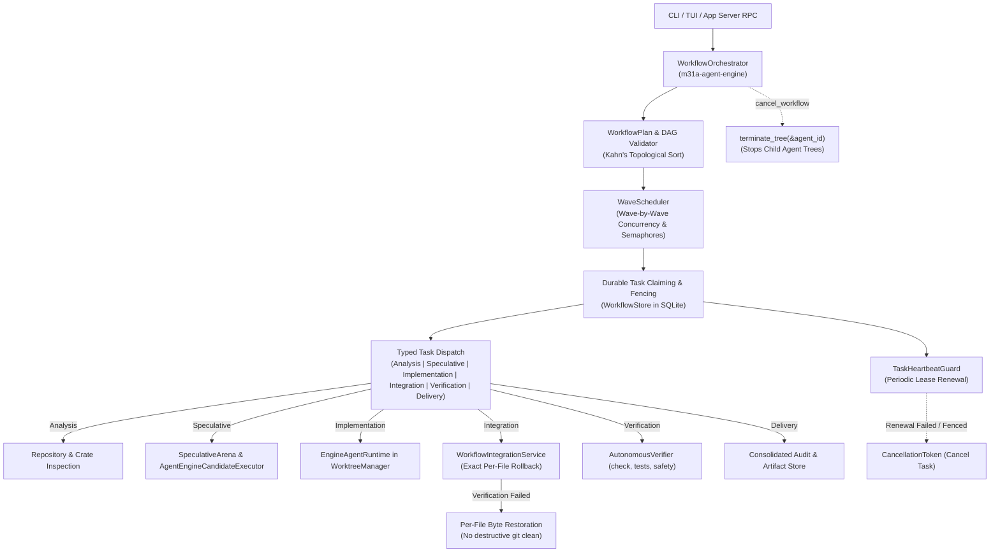

# M31A Workflow Execution Architecture — Round 2 Remediation

**System:** M31A Autonomous Engineering Platform  
**Target:** 39-Crate Rust 2024 Workspace  
**Status:** Authoritative Production Architecture  
**Milestone:** Execution Integrity & Orchestration Closure (Round 2)

---

## 1. Executive Summary

This document defines the authoritative architecture for autonomous workflow orchestration and speculative execution in M31A. The architecture enforces one non-negotiable governing invariant:

> **Governing Invariant:**  
> M31A may report an engineering task as completed only when its actual execution has succeeded, all required acceptance criteria have been satisfied, the resulting evidence has been persisted successfully, and any required integration has been safely authorized and completed.

Any path that fails execution, encounters a lease expiration, detects write-path conflict, suffers an agent failure, fails post-integration verification, or lacks mandatory approval **fails closed**. No task is marked completed on process spawn, speculative hallucination, or unverified diff application.

---

## 2. Architectural Topology

Workflow execution spans nine cooperating subsystems across the existing 39-crate architecture, strictly avoiding duplicate runtimes, duplicate schedulers, or first-party auth layers:

---

## 3. Subsystem Specifications

### 3.1 Durable Task Claiming, Heartbeats, and Attempt Fencing
Every task execution follows strict transactional leasing:
1. **Durable Claiming (`claim_task`)**:
   - A worker claims a task by specifying a positive lease duration (`lease_duration_ms > 0`).
   - The query verifies that the workflow is active and all upstream dependencies in `workflow_task_dependencies` have reached `status = 'completed'`.
   - Write paths are checked against concurrent non-isolated tasks in the same workflow to avoid write-path collisions.
   - Upon claim, `status` becomes `claimed`, `worker_id` is assigned, `lease_expires_at_epoch_ms` is set, and `attempt_id` is atomically incremented (`attempt_id = attempt_id + 1`).
2. **Heartbeat Guard (`TaskHeartbeatGuard`)**:
   - While the task runs, a background heartbeat ticker executes at `lease_duration_ms / 3` intervals.
   - It invokes `store.renew_task_lease(&wf_id, &task_id, &worker_id, attempt_id, lease_duration_ms)`.
   - If renewal returns `false` (indicating lease expiration or attempt preemption by a newer worker attempt) or an error, the heartbeat triggers `task_cancel_token.cancel()`.
3. **Fenced Result Persistence (`update_task_execution_result`)**:
   - When updating task outcome, `expected_attempt_id` and `expected_worker_id` are strictly checked in the `UPDATE` statement along with `lease_expires_at_epoch_ms > now`.
   - If 0 rows are affected, it returns an explicit error (`Err(Fencing violation or stale lease)`). Errors are propagated with `?` rather than silently discarded (`let _ =`).
   - When a task completes, downstream `pending` tasks whose dependencies are satisfied are automatically promoted to `ready`.

### 3.2 Speculative Arena & Candidate Competition
Speculative stages utilize real LLM reasoning and isolated workspaces:
1. **Hypothesis Generation**: `generate_diverse_hypotheses_with_provider` generates distinct algorithmic approaches.
2. **Real Candidate Executor (`AgentEngineCandidateExecutor`)**:
   - Competing candidates run in isolated temporary workspaces or worktrees using real LLM turns (`run_turn`), actual tools (`write_file`, `apply_patch`), and strict execution policies.
   - Candidate execution is bounded by `tokio::time::timeout`. If a candidate times out, its cancellation token is cancelled immediately.
3. **Git Status Parsing (`parse_porcelain_path`)**:
   - Modified files are extracted by parsing standard git porcelain format, handling index/working-tree status codes, quotes, and renames.
4. **Scoring Policy 2.0.0**:
   - Evaluated under Scoring Policy Version `2.0.0`.
   - Unmeasured performance benchmarks score `0.0` points (previously `10.0`), preventing unbenchmarked hypotheses from gaining unearned score advantage over verified functional solutions.

### 3.3 Authoritative Integration Service & Exact Per-File Rollback
Direct agent integration and speculative candidate promotion both route through `WorkflowIntegrationService`:
1. **Human Approval Gating**:
   - When `require_approval` is set, integration requires `is_approved: true`. Unapproved requests return `IntegrationOutcome { success: false, approval_granted: false, error: ... }` and do not modify the working tree.
2. **Path Traversal Protection**:
   - Every file path in patch operations is validated to ensure it does not escape the workspace root (`canonicalize` containment check). Path traversal attempts fail closed.
3. **Exact Per-File Byte Snapshots (`FileSnapshot`)**:
   - Before any patch is applied, pre-integration snapshots (`FileSnapshot::Existing` with SHA-256 or `FileSnapshot::NonExistent`) are recorded for every target path.
   - If post-integration verification (`AutonomousVerifier::verify_check` or `AutonomousVerifier::verify_tests`) fails:
     - Exact bytes are rewritten for pre-existing files.
     - Created files are safely unlinked.
     - **No destructive git cleanups** (`git clean -fd` or `git checkout -- .`) are ever executed, preserving untracked developer files outside the task scope.

### 3.4 Agent Tree Cancellation
When `WorkflowOrchestrator::cancel_workflow(workflow_id, reason).await` is called:
1. The workflow-level cancellation token is signalled, triggering cancellation of all active task tokens and heartbeat guards.
2. All child agent IDs registered under `active_agent_ids` are systematically terminated via `rt.terminate_tree(&agent_id).await`, ensuring background LLM child loops and process trees do not leak.
3. Workflow state in storage is updated to `WorkflowState::Cancelled`.
4. All non-terminal tasks are updated to `WorkflowTaskStatus::Cancelled`.
5. A durable `WorkflowCancelled` audit event is recorded.

---

## 4. Verification and Health Guarantees

| Invariant | Mechanism | Failure Mode |
|---|---|---|
| Zero False-Positive Completion | Strict `execute_task` outcome check requiring `success && verif_passed` | Task marked `Failed` |
| Attempt Fencing | `WHERE attempt_id = ? AND worker_id = ? AND lease_expires > now` | `Fencing violation` error, rejected |
| No Silent Error Swallowing | Storage result update propagated with `?` | Workflow propagates error and fails wave |
| Isolated Concurrency | Wave write-path conflict isolation + `Semaphore` | Conflicting tasks forced to consecutive waves |
| Safe Rollback | `FileSnapshot` byte restoration | Preserves developer files, restores exact state |
| Agent Lifecycle Closure | `terminate_tree(&agent_id).await` | Kills child process & subagent tree |
