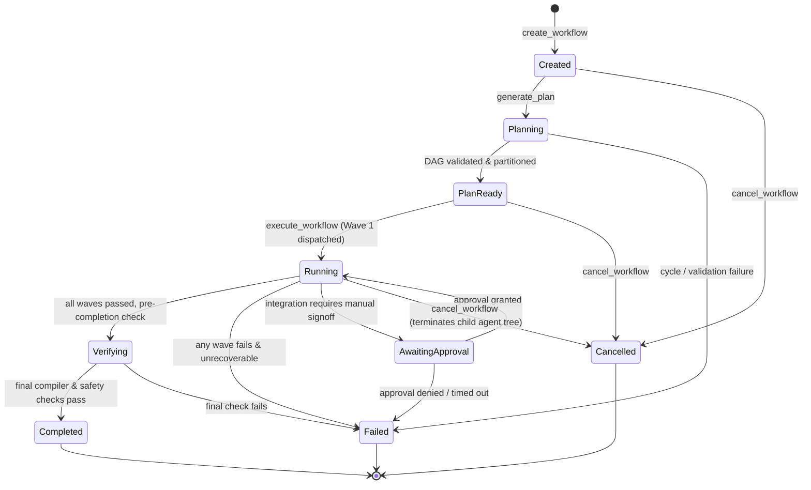
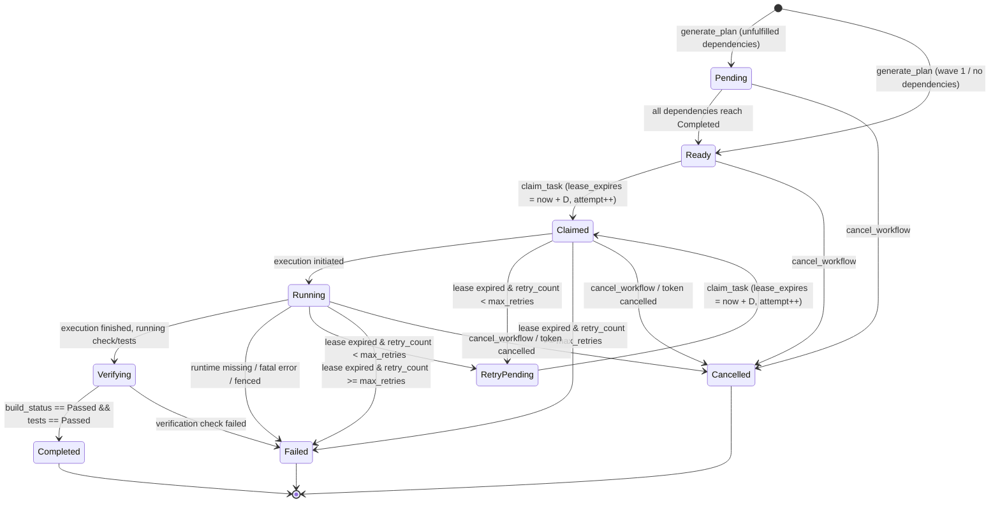

# M31A Workflow State Machine Specification

**System:** M31A Autonomous Engineering Platform  
**Target:** 39-Crate Rust 2024 Workspace  
**Status:** Authoritative State Machine Specification  
**Milestone:** Execution Integrity & Orchestration Closure (Round 2)

---

## 1. Overview

This document specifies the authoritative state machines governing workflow runs (`WorkflowRun`) and individual workflow tasks (`WorkflowTask`). State transitions in M31A are durable, transactional, and fenced against race conditions and expired worker claims.

---

## 2. Workflow Run State Machine

### 2.1 Transition Table: WorkflowRun

| From State | Event / Trigger | Preconditions | To State | Side Effects |
|---|---|---|---|---|
| `*` (non-terminal) | `create_workflow` | Valid workspace root | `Created` | DB record inserted; `WorkflowCreated` event emitted |
| `Created` | `generate_plan` | Non-empty objective | `Planning` -> `PlanReady` | Tasks persisted; Kahn's topological sort & wave partitioning verified |
| `PlanReady` | `execute_workflow` | Valid tasks in store | `Running` | Semaphore initialized; Wave 1 dispatched |
| `Running` | Wave completion | All wave tasks completed | `Verifying` | Final primary workspace `AutonomousVerifier::verify_check` initiated |
| `Verifying` | Verification success | `verify_check.success == true` | `Completed` | `completed_at_epoch_ms` set; `delivery_summary.json` stored; `WorkflowCompleted` event |
| `Verifying` | Verification failure | `verify_check.success == false` | `Failed` | Failure reason recorded; workflow halted |
| `Running` | Wave failure | Any task failed in wave | `Failed` | `update_workflow_state` to `Failed`; event emitted |
| `Running` | Approval required | Integration gated by config | `AwaitingApproval` | Event emitted; execution suspended until token provided |
| `Any non-terminal` | `cancel_workflow` | Caller requests cancellation | `Cancelled` | Cancellation token signalled; `terminate_tree(&agent_id)` terminates child agents; non-terminal tasks cancelled; `WorkflowCancelled` event |

---

## 3. Workflow Task State Machine

### 3.1 Transition Table: WorkflowTask

| From State | Event / Trigger | Invariant / Preconditions | To State | Fencing & Lease Semantics |
|---|---|---|---|---|
| `Pending` | Upstream Completion | All dependency tasks have `status = 'completed'` | `Ready` | Auto-promoted by `update_task_execution_result` in SQLite transaction |
| `Ready` / `RetryPending` / `Pending`* | `claim_task` | No write-path conflicts with active tasks; dependencies completed; `lease_duration > 0` | `Claimed` | `attempt_id = attempt_id + 1`; `lease_expires = now + D`; `worker_id` recorded |
| `Claimed` | `execute_task` start | Worker matches claim | `Running` | `TaskHeartbeatGuard` spawned |
| `Running` | Heartbeat tick | Active claim; `lease_expires > now` | `Running` | `lease_expires = now + D`; attempt validated |
| `Running` | Verification phase | Core execution succeeded | `Verifying` | Verification suite running (`AutonomousVerifier`) |
| `Verifying` | Verification pass | `build_status == Passed`, `tests_status == Passed` | `Completed` | Atomic update with `attempt_id` check; `TaskHeartbeatGuard` stopped |
| `Verifying` | Verification fail | Build or tests failed | `Failed` | Atomic update with `attempt_id` check; error recorded |
| `Claimed` / `Running` | `reconcile_stale_tasks` | `lease_expires < now` and `retry_count < max_retries` | `RetryPending` | `retry_count++`; `worker_id = NULL`; `lease_expires = NULL` |
| `Claimed` / `Running` | `reconcile_stale_tasks` | `lease_expires < now` and `retry_count >= max_retries` | `Failed` | `completed_at_epoch_ms = now`; failure reason logged |
| `Any non-terminal` | `cancel_workflow` | Cancel token triggered | `Cancelled` | Child agent aborted; task marked `Cancelled` |

*\* Note: `claim_task` allows direct claim of a `Pending` task if and only if all its dependencies are verified completed in the database at the time of claim.*

---

## 4. Invariant Enforcement & Fencing

### 4.1 Monotonic Attempt IDs
Every claim atomically increments `attempt_id = attempt_id + 1`. All subsequent lease renewals and outcome submissions must include the exact `expected_attempt_id` and `expected_worker_id`. If a superseded worker whose lease expired tries to submit results after reconciliation, the update matches 0 rows and returns `Err(Fencing violation)`, guaranteeing that stale workers can never overwrite active or recovered execution state.

### 4.2 Terminal State Immutability
Once a task or workflow transitions to a terminal state (`Completed`, `Failed`, `Cancelled`), further state transitions are rejected. Resuming an already completed workflow returns the existing record immediately without re-executing tasks or resetting attempts.
