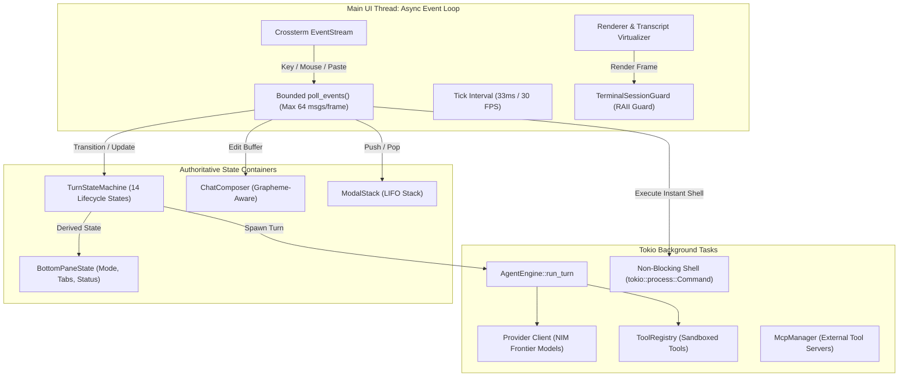

# M31A TUI — System Architecture Specification

## 1. Architectural Overview & Design Philosophy

The `crates/m31a-tui` subsystem serves as the mission-critical human-agent interface for the M31A autonomous engineering assistant. Built on Rust, [Ratatui](https://ratatui.rs), and [Crossterm](https://github.com/crossterm-rs/crossterm), it manages asynchronous LLM turn execution, live streaming token virtualization, interactive tool approval dialogs, subagent hierarchy inspection, dynamic workspace trust evaluation, and non-blocking process supervision.

### Core Architectural Principles
1. **Zero UI Loop Starvation**: No blocking synchronous calls (filesystem, network, database, shell, LLM invocation) ever execute on the terminal event loop thread.
2. **Deterministic State Derivation**: Visual status badges, spinner animations, and input modes are strictly derived from a central canonical `TurnStateMachine`.
3. **Correlation-Guarded Asynchrony**: All asynchronous messages include an `EventCorrelation` token containing `session_id`, `session_epoch`, and `turn_id`. Outdated events from superseded or cancelled operations are discarded.
4. **Guaranteed Terminal Restoration**: A dedicated RAII guard (`TerminalSessionGuard`) ensures that alternate screen mode, mouse capture, raw mode, bracketed paste, and cursor visibility are restored even if the application panics or is terminated abnormally.



---

## 2. State Domains & Ownership

To resolve competing ownership between modules, `App` delegates state management into 12 coherent state domains:

### 2.1 Application Lifecycle
- Owned by `App`: `should_quit`, `is_focused`, `session_epoch`, `last_ctrl_c_press`.
- Manages double Ctrl+C exit handling, graceful shutdown draining, and terminal restoration.

### 2.2 Canonical Turn State Machine
- Owned by `turn::TurnStateMachine`.
- Represents the 14 explicit states: `Idle`, `Submitted`, `AwaitingAdmission`, `Thinking`, `Streaming`, `ExecutingTool`, `AwaitingApproval`, `AwaitingUserQuestion`, `Compacting`, `CancellationRequested`, `Cancelling`, `Completed`, `Failed`, and `Recovering`.
- Forbids invalid state transitions (e.g., jumping from `Streaming` to `Idle` without cancellation confirmation).

### 2.3 Authoritative Composer & Input Buffer
- Owned by `composer::ChatComposer` and synchronized to `bottom_pane::BottomPaneState`.
- Employs `unicode_segmentation::UnicodeSegmentation` for grapheme-cluster-aware navigation and deletion.
- Employs `unicode_width::UnicodeWidthStr` for display column width calculation and viewport scrolling.
- Tracks multi-level undo/redo snapshots with an in-memory stack bounded at 50 snapshots.

### 2.4 Transcript & Virtualization
- Owned by `app.transcript` (`Vec<TranscriptItem>`) and `app.transcript_virtualizer` (`TranscriptVirtualizer`).
- Formats markdown headers, fenced code blocks, callouts, latex math, and mermaid flowcharts.
- Implements terminal-width-aware row measurement (`measure_cell_rendered_height`).
- Automatically groups consecutive read-only exploration tools (`glob`, `grep`, `file_read`) into expandable accordion cells, preserving expanded states across incremental token deltas.

### 2.5 Modal Stack Lifecycle
- Owned by `modals::ModalStack`.
- Implements a true LIFO stack for multi-layer dialogs (e.g., `Settings` -> `ConfirmationDialog` -> `SelectPicker`).
- Pressing `Esc` pops the topmost modal, accurately returning focus to the underlying parent modal rather than blanking navigation context.

### 2.6 Tool Execution, Approvals & Sandboxing
- Owned by `app.approval_tx`, `app.rich_approval_tx`, and `app.exec_policy`.
- Coordinates with `m31a-execpolicy` to enforce user security rules. Supports `AllowOnce`, `Deny`, and `AlwaysAllowPattern` prefix rule synthesis.

### 2.7 Workspace & Trust Context
- Owned by `app.cwd`, `app.trust_store`, and `app.git_status`.
- Re-evaluates path security using `m31a_trust::TrustStore` on startup and on every directory change.
- Blocks tool execution, instant shell commands, and git patch application if the working directory is untrusted (`RequiresConfirmation` or `Denied`).

### 2.8 Subagent Hierarchy & Process Supervision
- Owned by `app.subagent_tabs`, `app.active_thread_id`, and `app.storage`.
- Enables drilling down into child agent threads to inspect localized tool calls and prompt context.
- Allows terminating subagent trees cleanly and synchronizing SQLite storage without orphaned database edges.

### 2.9 MCP Hub Management
- Owned by `app.mcp_manager` (`Arc<McpManager>`) and `app.config.mcp_servers`.
- Allows enabling and disabling configured external Model Context Protocol servers at runtime.

### 2.10 Model Catalog & Provider Switching
- Owned by `app.active_model`, `app.nim_client`, and `app.available_models`.
- Switches frontier NIM models dynamically, falling back safely to the previous provider client if initialization fails.

### 2.11 Metrics & Token Tracking
- Owned by `app.metrics` and `app.bottom_pane.token_meter`.
- Truthfully tracks verified reasoning tokens, total prompt tokens, and context window percentages. Fake or placeholder constants are strictly prohibited.

### 2.12 Terminal Capabilities & Color Palette
- Owned by `app.term_caps` and `theme::THEME`.
- Automatically detects truecolor (24-bit), 256-color, or 16-color ANSI support, Hyperlinks, and dark/light background luminance via OSC query responses.

---

## 3. Threading, Async Topology & Event Loop

The TUI operates on an asynchronous Tokio runtime architecture with clear boundary separation:

```mermaid
sequenceDiagram
    participant User as Terminal / User
    participant Loop as Main Loop (terminal.rs)
    participant App as App State (app.rs)
    participant Task as Background Task (Tokio)
    participant Engine as AgentEngine

    User->>Loop: KeyPress (e.g. Enter)
    Loop->>App: handle_composer_key_event()
    App->>App: TurnStateMachine::transition_submitted()
    App->>Task: tokio::spawn(AgentEngine::run_turn)
    Note over Loop: Loop remains non-blocking (30 FPS)
    Loop->>Loop: Render Frame (Spinner animating)

    Task->>Engine: Stream token chunk
    Engine-->>Loop: TuiEvent::ContentChunk(correlation, chunk)
    Loop->>App: poll_events()
    App->>App: Validate correlation epoch & turn_id
    App->>App: TurnStateMachine::transition_streaming()
    App->>App: Append token to virtualizer
    Loop->>Loop: Render Frame (Updated text)

    User->>Loop: KeyPress (Ctrl+C)
    Loop->>App: handle_global_shortcut_event()
    App->>App: cancel_turn() -> session_epoch++
    App->>Task: cancellation_token.cancel()
    Task-->>Loop: TuiEvent::TurnCancelled(old_correlation)
    App->>App: Verify epoch mismatch -> Safely drop stale event
    App->>App: TurnStateMachine::force_idle()
```

### 3.1 Bounded Backpressure & Fairness
The internal event channel (`app.event_tx` / `app.event_rx`) is a bounded MPSC channel with a buffer capacity of 1024 messages.
During each frame in `app.poll_events()`:
1. Up to 64 events are polled and processed per frame cycle.
2. Excess events remain buffered in the channel, ensuring the UI draw routine executes reliably at 30 FPS without being starved by rapid model streaming.
3. Every polled event is validated against `app.session_epoch` and `app.current_turn_id`. Stale events from previous sessions or aborted turns are silently dropped.

---

## 4. Cancellation Model & Resource Reclamation

Cancellation in M31A TUI is an explicit 7-stage lifecycle:
1. **Interrupt Request**: User presses `Ctrl+C` while `turn_state.is_active()`.
2. **Transition**: `TurnStateMachine` transitions `Active -> CancellationRequested -> Cancelling`.
3. **Token Cancellation**: `app.cancel_token.cancel()` is triggered, broadcasting cancellation to the async engine, tool executors, and subprocess runners.
4. **Subprocess Reaping**: Any running instant shell subprocess or sandboxed tool runner is killed with `SIGKILL` or terminated via PID process tree traversal.
5. **Epoch Invalidation**: `app.session_epoch` is incremented by 1. Any delayed streaming chunks or tool completion events arriving in the channel will fail epoch validation and be safely discarded.
6. **Persistence**: The interrupted partial state is recorded in SQLite without corrupting the thread conversation history.
7. **Settle to Idle**: `TurnStateMachine::force_idle()` resets state flags, composer mode, and status badges.
