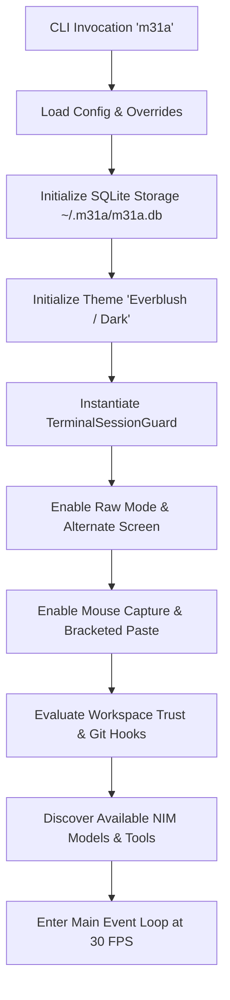
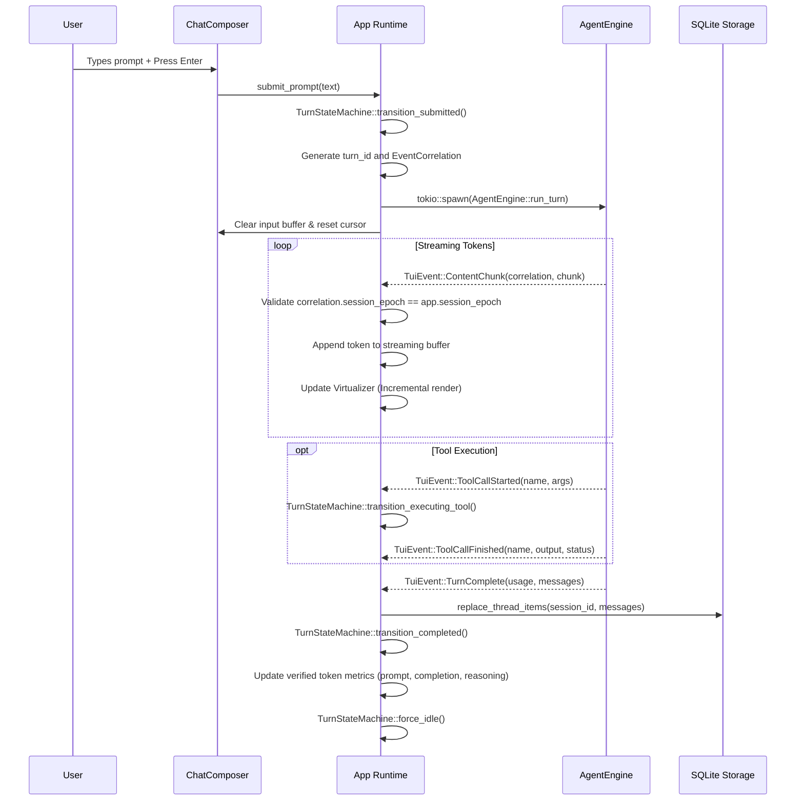
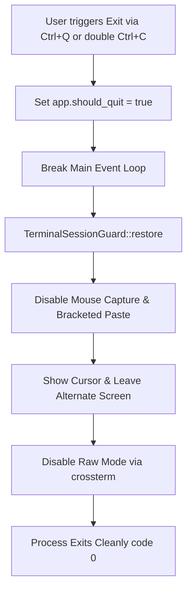

# M31A TUI — Session Lifecycle Specification

This specification documents the complete lifecycle of an M31A interactive session from launch through turn execution, branch management, subagent supervision, resumption, context compaction, and clean shutdown.

---

## 1. Session Initialization & Startup

When the user launches `m31a` in interactive mode, initialization proceeds through the following sequential stages:

### Invariants:
1. If the current working directory is untrusted, an error notice is posted to the transcript and tool execution is disabled until explicitly authorized via `/trust session` or `/trust add`.
2. Storage is initialized with foreign key enforcement enabled (`PRAGMA foreign_keys = ON;`).
3. `TerminalSessionGuard` enters raw mode before Ratatui initializes CrosstermBackend.

---

## 2. Turn Execution Lifecycle

### Transactional Persistence Guarantee:
On `TuiEvent::TurnComplete`, `app.storage.replace_thread_items(&self.session_id, &messages)` replaces the entire conversation thread items inside a single atomic SQLite transaction. This strictly prevents duplicating historical messages across turns.

---

## 3. Subagent Tree, Drill-Down & Termination

M31A allows coordinating complex autonomous workflows via hierarchical subagent trees:

1. **Subagent Spawning**:
   - Subagents are registered in SQLite `threads` with parent-child relationships recorded in `spawn_edges`.
   - Active subagents are surfaced as interactive tabs on the bottom pane tab bar.
2. **Subagent Drill-Down (`switch_subagent_view`)**:
   - Selecting a subagent tab or using `/agents` drills down into that subagent's view context.
   - `app.active_thread_id` is updated to the child's `thread_id`.
   - The transcript is cleared and re-populated exclusively with items belonging to that child thread from SQLite.
   - Status badges display the active subagent's role and model.
3. **Return to Root**:
   - Clicking Tab 0 `[Main Session]` or pressing `Alt+Left` resets `app.active_thread_id` to `None`.
   - The transcript restores the primary thread conversation.
4. **Subagent Termination (`terminate_subagent`)**:
   - Selecting a subagent in `/agents` and pressing `k` triggers termination.
   - Subprocess resources associated with the child are reaped.
   - The subagent tab is removed from `bottom_pane.subagent_tabs`.
   - The thread record is updated in SQLite to mark status as terminated.

---

## 4. Session Resumption & Branching

Previous sessions can be resumed at any time using `/resume` or `Ctrl+R`:

1. **Safety Pre-Check**:
   - If a turn is currently active, it is immediately cancelled via `app.cancel_turn()` to prevent state collision.
2. **State Reset**:
   - `app.session_epoch` is incremented.
   - `app.turn_state.force_idle()` resets the state machine.
   - Active subagent tabs and queued prompts are cleared.
3. **Session Rehydration**:
   - `app.session_id` is switched to the target session ID.
   - Thread metadata and conversation messages are loaded from SQLite storage.
   - Provider client is rebuilt according to the resumed session's configured model.
   - Workspace trust is re-evaluated for the resumed session's working directory.

---

## 5. Context Compaction Lifecycle

When the conversation token count approaches the frontier model's maximum context window:
1. `CompactTokenBudget` threshold is exceeded during streaming.
2. `TurnStateMachine` transitions `Streaming -> Compacting`.
3. Background context compactor summarizes earlier turns using heuristic relevance and structural semantic clustering.
4. Old message items are collapsed into a structured summary checkpoint in SQLite storage.
5. Virtualizer is synchronized with the compacted message history.
6. `TurnStateMachine` returns to `Streaming`.

---

## 6. Interrupts, Cancellation & Process Supervision

When the user presses `Ctrl+C` during an active turn:
1. `app.cancel_turn()` is invoked.
2. `app.turn_state` transitions `CancellationRequested -> Cancelling`.
3. `app.cancel_token.cancel()` notifies the running `AgentEngine`.
4. Any active tool subprocess (such as shell commands or compiler builds) is terminated with `SIGKILL`.
5. `app.session_epoch` is incremented, ensuring any delayed events in the async channel are dropped.
6. The partial transcript item is marked as interrupted with a warning notice.
7. `app.turn_state` transitions to `Idle`.

---

## 7. Clean Shutdown & Panic Safety

### Panic Safety:
`TerminalSessionGuard` implements `Drop`. If a panic occurs anywhere in the UI loop, Rust's unwinding mechanism executes `TerminalSessionGuard::drop()`, restoring standard terminal mode before printing backtrace information. The user's terminal is never left in an unreadable or bricked state.
