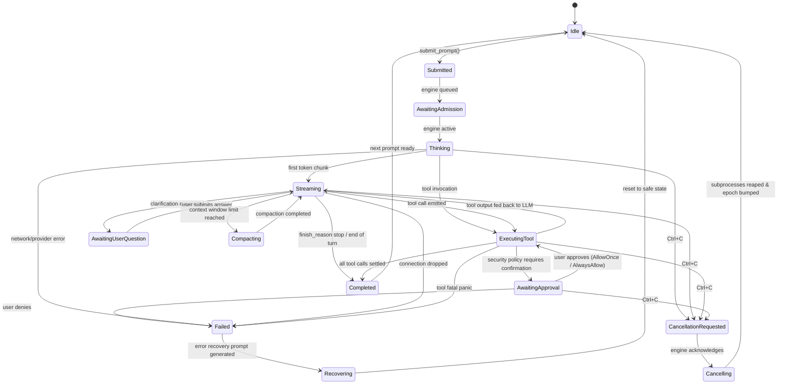
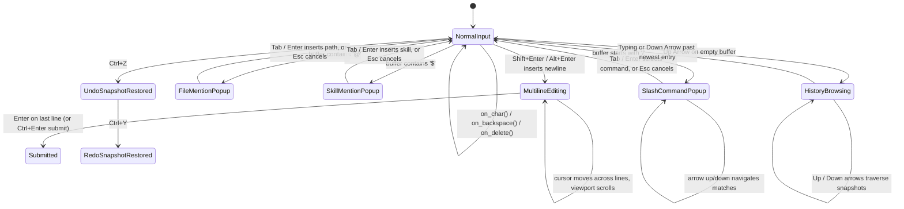
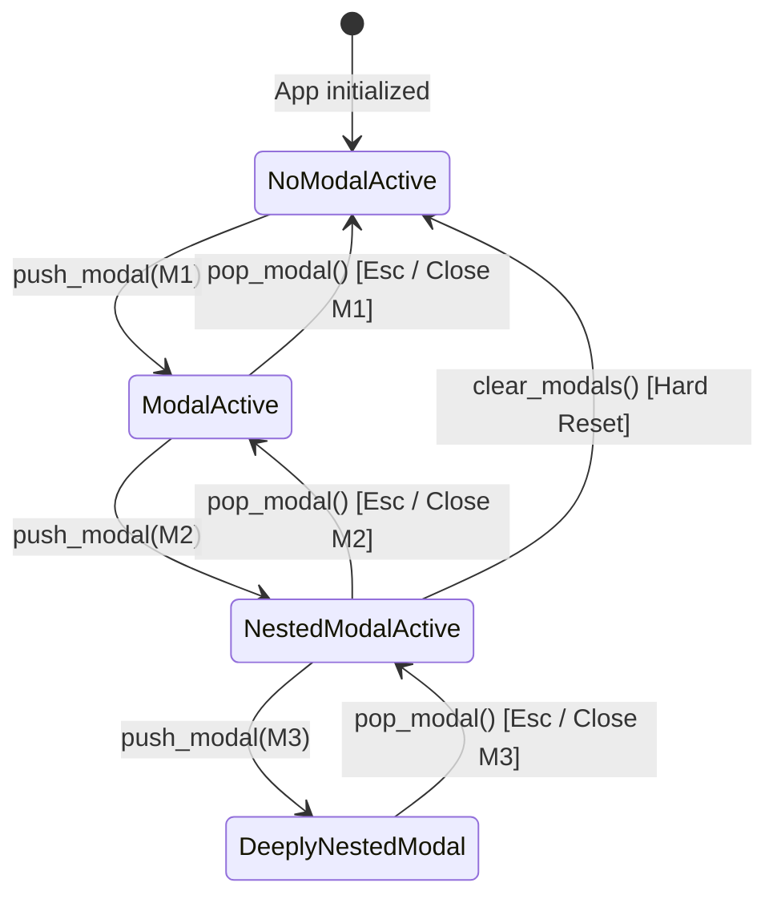
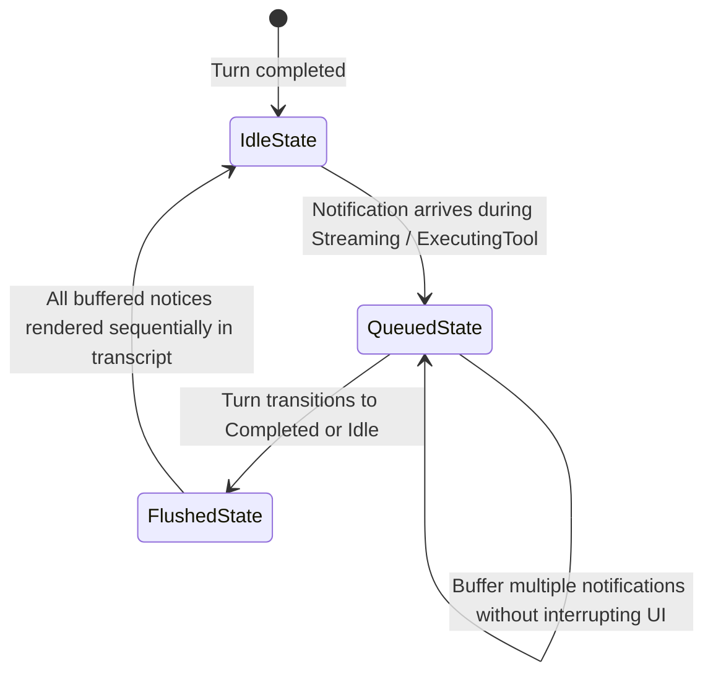

# M31A TUI — State Machines Specification

This document defines the formal state machines governing the M31A terminal user interface, including legal transitions, invariants, and failure recovery.

---

## 1. Canonical Turn State Machine (`turn::TurnStateMachine`)

The turn lifecycle represents the single source of truth for all turn execution. No visual component or background thread may invent turn status independently.



### Transition Legality Table

| From State | Allowed Target States | Illegal Target States (Rejected with Error) |
|---|---|---|
| `Idle` | `Submitted` | `Streaming`, `ExecutingTool`, `Completed`, `Cancelling` |
| `Submitted` | `AwaitingAdmission`, `Thinking`, `CancellationRequested`, `Failed` | `Completed`, `Idle` (without cancel) |
| `AwaitingAdmission` | `Thinking`, `CancellationRequested`, `Failed` | `Streaming`, `Completed` |
| `Thinking` | `Streaming`, `ExecutingTool`, `CancellationRequested`, `Failed` | `Idle`, `Completed` |
| `Streaming` | `ExecutingTool`, `AwaitingUserQuestion`, `Compacting`, `Completed`, `CancellationRequested`, `Failed` | `Idle`, `Submitted` |
| `ExecutingTool` | `Streaming`, `AwaitingApproval`, `Completed`, `CancellationRequested`, `Failed` | `Idle`, `Thinking` |
| `AwaitingApproval` | `ExecutingTool`, `Failed`, `CancellationRequested` | `Completed`, `Idle` |
| `AwaitingUserQuestion`| `Streaming`, `CancellationRequested`, `Failed` | `Completed`, `Idle` |
| `Compacting` | `Streaming`, `CancellationRequested`, `Failed` | `Idle` |
| `CancellationRequested`| `Cancelling`, `Failed` | `Streaming`, `Completed`, `Idle` |
| `Cancelling` | `Idle`, `Failed` | `Streaming`, `Thinking`, `Completed` |
| `Completed` | `Idle` | `Streaming`, `ExecutingTool` |
| `Failed` | `Recovering`, `Idle` | `Streaming`, `Completed` |
| `Recovering` | `Idle` | `Streaming`, `Completed` |

---

## 2. Composer & Input State Machine (`composer::ChatComposer`)



### Invariants:
1. `cursor` is always positioned at a valid UTF-8 boundary and grapheme cluster offset.
2. `viewport_offset` never exceeds the maximum rendered lines in the composer area.
3. Every mutating keystroke pushes a snapshot to `undo_stack` and clears `redo_stack`.

---

## 3. Modal Stack Lifecycle Machine (`modals::ModalStack`)



### Invariants:
1. The currently rendered modal is always `modal_stack.last()`.
2. Popping a modal immediately restores keyboard and mouse focus to the previous modal on the stack.
3. When the stack reaches depth 0, main chat and composer view receive input focus.

---

## 4. Subagent Hierarchy & Tab Machine

```mermaid
stateDiagram-v2
    [*] --> RootSessionView: Active thread = Main Session (Tab 0)

    RootSessionView --> SubagentView: switch_subagent_view(child_thread_id)
    Note over SubagentView: Transcript displays child messages only.<br/>Status badges highlight child role.

    SubagentView --> SubagentView: Alt+Left / Alt+Right cycles active subagent tabs
    SubagentView --> RootSessionView: switch_subagent_view(None) or click Tab 0

    SubagentView --> SubagentTerminated: terminate_subagent(child_thread_id)
    SubagentTerminated --> RootSessionView: tab removed, thread cleaned up, return to root
```

---

## 5. Deferred Interrupt & Notification Buffer Machine


